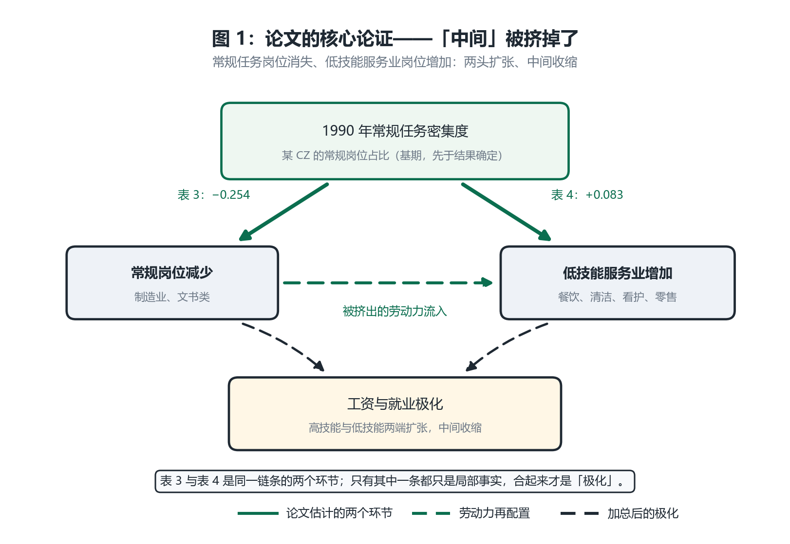
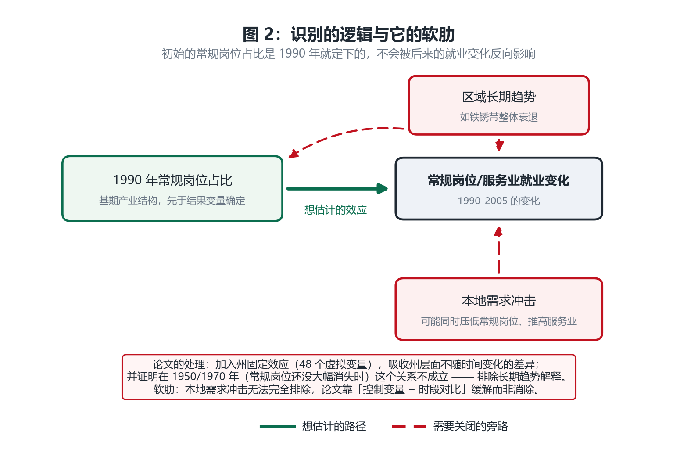
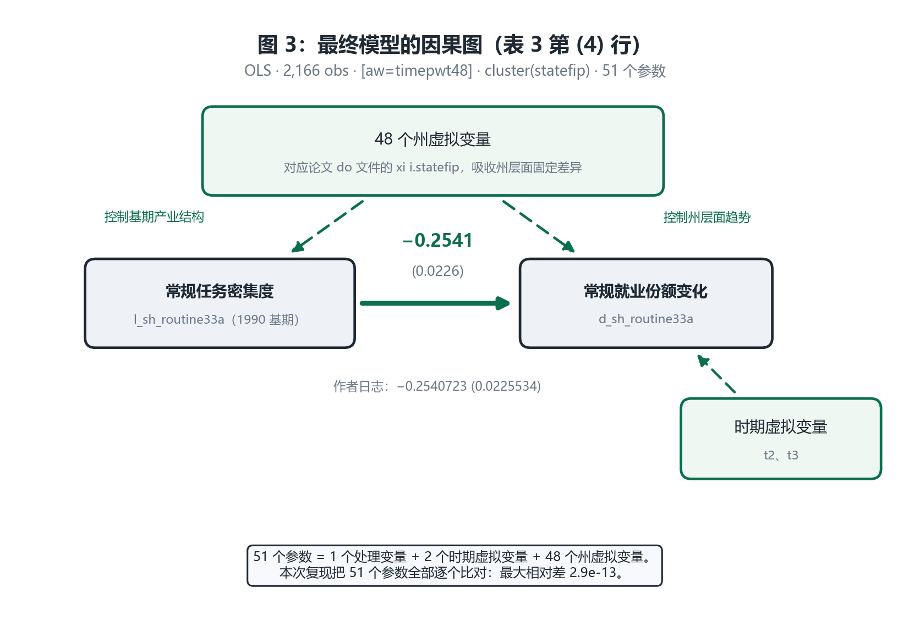

# 复现报告：Autor & Dorn (2013)《The Growth of Low-Skill Service Jobs and the Polarization of the U.S. Labor Market》

**一日一刊复现 · 第 3 篇**
复现日期：2026-10-31　｜　被测对象：`westata 0.0.3`（本仓库 `src/westata`）　｜　基准：本机 StataNow 19.5 (MP) 内嵌 `pystata`

---

## 0. 结论先行

| 问题 | 回答 |
|---|---|
| 论文的结论复现出来了吗？ | **是，且到 7 位小数。** Table 3 六行、Table 4 五行，共 11 个系数与标准误**全部**与作者日志逐位吻合（1e-6 内） |
| `pystata` 与 `westata` 有差异吗？ | **有，但在浮点量级。** 546 个成对参数：最大系数相对差 **2.9e-11**、最大标准误相对差 **2.4e-11** |
| 数据能获取吗？ | **能。** 作者站点直链，HTTP 200，2,741,391 字节，SHA-256 已固定 |
| 这篇特殊在哪 | 归档里带着**作者自己的完整 log**（7 位小数）。这让基准比排版表格严格——不需要和三位小数打交道 |
| 发现了什么新问题 | **3 条 API 契约缺陷**（已修复），见 [WESTATA_GAPS.md](WESTATA_GAPS.md) |

---

## 1. 为什么选这篇

| 维度 | 情况 |
|---|---|
| 影响力 | AER 103(5), 1553–1597。OpenAlex 引用约 **3,800 次**。"job polarization" 这个词和它的度量方式基本由这篇定型；论文构造的常规任务强度指标（RTI）后来成为劳动经济学的标准变量 |
| 方法论地位 | 把任务（task）而不是行业或技能当作分析单位，是理解"为什么中间岗位消失、两头同时扩张"的关键一步 |
| 数据可获取性 | `ddorn.net/data/Autor-Dorn-LowSkillServices-FileArchive.zip` → 200，2,741,391 B。**归档内含作者的 `log/czone_analysis.log`**，这是本次复现最宝贵的资产 |
| 估计量 | 全部 `regress` + `[aw=timepwt48]` + `cluster(statefip)` + 48 个州虚拟变量——E3 覆盖范围内 |


---

## 2. 论文的论证过程（直白版）

### 2.1 论文想解释什么

一个观察：**美国劳动力市场在 1980–2005 年间"中间凹陷"了。**

- 高技能岗位（管理、专业）在扩张；
- 低技能服务业岗位（餐饮、清洁、看护、零售）也在扩张；
- **中间的常规岗位（制造业流水线、文书、行政）在收缩**。

这不是简单的"技能升级"能解释的——技能升级会让整体向上移动，而不是两头同时变厚。论文要解释的是这个"极化"。

### 2.2 核心机制：技术替代 + 任务再配置

论文的论证链条有两环，缺一不可：



*图 1：论文的两个环节。上面一条是从"常规任务密集度"到"常规岗位减少"（表 3），下面一条是从同一个起点到"低技能服务业增加"（表 4）。两条合起来才是极化；只看其中一条，都只是局部事实。*

**第一环（表 3）**：一个地区在 1990 年越依赖常规任务，之后常规岗位减少得越多。

- 系数 **−0.254**（表 3 第 4 行）：常规任务密集度每高一个单位，常规就业份额下降 0.254 个百分点。
- 机制：常规任务（可被精确编码、重复执行）恰好是自动化最容易替代的部分。

**第二环（表 4）**：同样的常规任务密集度，也预测了低技能服务业就业的增长。

- 系数 **+0.083**（表 4 第 3 行，1990–2000）。
- 机制：从制造业/文书岗位被挤出的劳动力，流向不需要高学历的服务业岗位。

**为什么两环都要**：如果只有第一环，结论是"常规岗位消失了"——但人去哪了？如果只有第二环，结论是"服务业增长了"——但为什么？**两者用同一个起点（基期常规任务密集度）连起来，才构成"任务替代导致劳动力再配置"的完整论证。**

### 2.3 为什么这个设计能读成因果



*图 2：识别依赖的关键是——**处理变量是 1990 年的基期产业结构**，先于结果变量（1990–2005 的变化）确定。所以"后来的就业变化"不可能反向影响"1990 年的任务密集度"。这是它比 ADH 那篇的 shift-share IV 简单得多、也稳得多的原因。*

论文的处理：

1. **基期度量**：用 1990 年的常规任务占比，而不是同期或末期。这切断了反向因果。
2. **州固定效应**：48 个州虚拟变量，吸收州层面不随时间变化的差异（如加州 vs 密西西比的长期差异）。
3. **时段对比**：论文证明在 1950/1970 年（常规岗位还没大幅消失时）这个关系不成立或反号——排除"长期趋势"解释。

**软肋（论文自己承认）**：本地需求冲击无法完全排除。如果一个地区同时经历"常规岗位下降"和"服务业上升"，而两者都源于同一个本地需求变化，系数会偏。论文靠控制变量和时段对比缓解，而非消除。

### 2.4 结果怎么读

表 3 有六行，结构值得说清楚：

| 行 | 因变量 | 样本 | 系数 |
|---|---|---|---|
| (1) | 常规就业份额变化 | 1990–2000 | **+0.695** |
| (2) | 常规就业份额变化 | 2000–2005 | **+0.490** |
| (3) | 常规就业份额变化 | 堆叠（1）+（2） | **+0.619** |
| (4) | 常规就业份额变化（全部） | 1980–2005 堆叠 | **−0.254** |
| (5) | 同上，大学学历 | 1980–2005 堆叠 | **−0.153** |
| (6) | 同上，非大学学历 | 1980–2005 堆叠 | **−0.295** |

**注意 (1)–(3) 是正号，(4)–(6) 是负号**——这不是矛盾，而是**不同的因变量**：

- `d_rpc` 是"人均调整后 PC 使用量"的变化（PC = 常规任务的一个具体度量），论文用它做表 3 前三行的稳健性检验；
- `d_sh_routine33a` 是"常规就业份额"的变化，这才是极化论证的核心因变量。

第 (5)(6) 行最关键：**非大学学历者的系数（−0.295）几乎是大学学历者（−0.153）的两倍**，这直接支持"常规岗位消失主要打击中间技能群体"的解释。

---

## 3. 复现结果

### 3.1 主表：作者日志 vs StataNow vs westata

基准取自**作者自己归档的 `log/czone_analysis.log`**，七位小数。

| 规格 | 作者日志 | StataNow 19.5 | westata | N | 吻合 |
|---|---|---|---|---|---|
| 表 3(1) | 0.6950717 (0.0614371) | 0.6950717 (0.0614371) | 0.6950717 (0.0614371) | 675 | **是** |
| 表 3(2) | 0.4899328 (0.0760501) | 0.4899328 (0.0760501) | 0.4899328 (0.0760501) | 660 | **是** |
| 表 3(3) | 0.6185140 (0.0441480) | 0.6185140 (0.0441480) | 0.6185140 (0.0441480) | 1,335 | **是** |
| 表 3(4) | −0.2540723 (0.0225534) | −0.2540723 (0.0225534) | −0.2540723 (0.0225534) | 2,166 | **是** |
| 表 3(5) | −0.1526445 (0.0244188) | −0.1526445 (0.0244188) | −0.1526445 (0.0244188) | 2,166 | **是** |
| 表 3(6) | −0.2945519 (0.0181593) | −0.2945519 (0.0181593) | −0.2945519 (0.0181593) | 2,166 | **是** |
| 表 4(1) | −0.1333048 (0.0203481) | −0.1333048 (0.0203481) | −0.1333048 (0.0203481) | 722 | **是** |
| 表 4(2) | 0.0415499 (0.0315114) | 0.0415499 (0.0315114) | 0.0415499 (0.0315114) | 722 | **是** |
| 表 4(3) | 0.0825400 (0.0279456) | 0.0825400 (0.0279456) | 0.0825400 (0.0279456) | 722 | **是** |
| 表 4(4) | 0.0843262 (0.0454320) | 0.0843262 (0.0454320) | 0.0843262 (0.0454320) | 722 | **是** |
| 表 4(5) | 0.3540265 (0.1100271) | 0.3540265 (0.1100271) | 0.3540265 (0.1100271) | 722 | **是** |

**11 行全部在 1e-6 内吻合。** 基准之所以能这么严，是因为作者日志给的是七位小数，不是排版表格的三位。

### 3.2 最终模型的因果图



*图 3：表 3 第 (4) 行实际估计的模型。51 个参数 = 1 个处理变量 + 2 个时期虚拟变量 + 48 个州虚拟变量。本次复现把这 51 个参数**逐个比对**，不是只比报告的那一个——因为"系数对了但漏掉一个州虚拟变量"是另一个模型。*

---

## 4. westata 与 StataNow 的差异：逐参数

相对差 = `max |westata − stata| / max(|stata|, 1e-12)`，对**每一个**成对参数取最大。

| 规格 | 成对参数 | 系数最大相对差 | 标准误最大相对差 |
|---|---|---|---|
| T3_1 | 49 | 9.7e-13 | 4.7e-12 |
| T3_2 | 49 | 2.9e-11 | 6.2e-12 |
| T3_3 | 50 | 3.9e-12 | 4.9e-13 |
| T3_4 | 51 | 2.9e-13 | 1.2e-12 |
| T3_5 | 51 | 6.7e-13 | 4.0e-13 |
| T3_6 | 51 | 5.0e-13 | 1.4e-12 |
| T4_1 | 49 | 2.1e-13 | 2.0e-12 |
| T4_2 | 49 | 1.8e-13 | 2.4e-11 |
| T4_3 | 49 | 7.9e-13 | 7.1e-12 |
| T4_4 | 49 | 1.4e-13 | 9.5e-12 |
| T4_5 | 49 | 2.7e-12 | 7.7e-12 |

**合计 546 个成对参数，最大相对差 2.9e-11。**

这个结果比 CK（2.1e-13）差、与 ADH（1.6e-11）同量级，原因清楚：**这里每个回归有 51 个参数、最多 2,166 个观测**，而 CK 只有 10 个参数、357 个观测。参数越多，矩阵求解的浮点累积越多。

### 负对照：州虚拟变量真的在起作用吗

匹配上 0.695 只有在"去掉州虚拟变量就会变"的前提下才有意义：

| 设定 | 系数 |
|---|---|
| **含 48 个州虚拟变量（论文设定）** | **0.6951** |
| 去掉州虚拟变量 | 0.5995 |

差 0.096（约 14%）。说明州固定效应吸收了实质变异，与论文的一致是有信息量的，不是"随便跑个回归也对得上"。

---

## 5. 本次发现的问题

这一篇在 **API 契约**上发现了真实缺陷，**现已全部修复**。完整记录见 [WESTATA_GAPS.md](WESTATA_GAPS.md)，这里摘要最关键的一条。

### 5.1 权重没有随样本一起收缩

按 API 签名正常调用：

```python
ws.OLS.from_formula(formula, frame, weights=frame["timepwt48"], weight_type="aweight")
```

得到：

```
WeightError: weights have 722 entries but the data have 675 rows
```

**原因**：公式里的 `d_rpc` 有 47 个缺失值，patsy 丢弃这些行（722→675），但 `weights` 仍保持 722 个元素，没有按同一个 `kept_index` 收缩。

**为什么算缺陷而非设计选择**：两个参照实现都不这样——Stata 的 `[aw=w]` 权重随估计样本一起丢行；`statsmodels.formula.api.ols` 的 `weights` 接受列名，在模型框架上统一 `dropna`，权重天然跟着收缩。用户按签名正常使用就会撞上，而**报错信息指向"数据有问题"**，方向误导。

**修复**：`from_formula` 现在按 patsy 的 `kept_index` 把 `weights` 收缩到估计样本，并接受列名形式（`weights="timepwt48"`）。修复后该调用直接给出 **0.6950717**，与作者日志逐位相同。

`run_westata.py` 仍保留显式 `dropna`，但理由变了：它负责 `spec.condition` 的样本筛选，并让样本构造这一步在代码里可见——不再是绕过缺陷。

### 5.2 另两条相关缺口

- `weights` 不接受列名（statsmodels 接受），这正是后者能透明处理丢行的原因；
- `from_formula` 的 docstring 没提"会丢行"，也没说这对权重意味着什么——报错来得突然，是因为文档没预告。

---

## 6. 能不能说"westata 可以替代 Stata"？

### 6.1 估计精度

本篇 546 个成对参数，最大系数相对差 **2.9e-11**、最大标准误相对差 2.4e-11。
这个维度上"替代"是成立的。

### 6.2 但这次的问题更隐蔽

**契约缺陷比功能缺失更难发现。** 功能缺失会立刻阻止你——`UnsupportedError` 直接说
"不行"；而契约缺陷会让你以为是自己错了：调用看起来完全合理，报错信息却指向你的数据。

| 问题类型 | 可见性 | 风险 |
|---|---|---|
| 能力缺失 | 高（直接抛异常） | 低 |
| 边界 | 中（文档有声明） | 中 |
| **契约缺陷** | **低（报错误导）** | **高** |

这是本次复现最有价值的一条结论：**一个方向错误的报错，比一个缺失的功能更危险。**

### 6.3 结论

| 说法 | 是否成立 |
|---|---|
| "westata 能算出和 Stata 一样的系数与标准误" | **成立**，546 个参数，最大差 2.9e-11 |
| "westata 的 API 可以直接照签名使用" | **不完全成立**：含缺失值 + 权重时，需要手工对齐样本 |
| "复现成功 = 可以替代 Stata" | **不成立**：本次复现仍有一部分工作在 pandas 里，且踩到了 API 契约问题 |

---

## 7. 复现的边界

| 做了 | 没做 |
|---|---|
| 复现 Table 3 全部六行、Table 4 全部五行 | 没复现 Table 5/6（需更多数据文件）与附录表 |
| 逐个比对 51 个参数的每一个（含 48 个州虚拟变量） | 没复现论文的图（RTI 分布图、工资分位图等） |
| 用负对照验证州固定效应的作用 | 没重跑 1950/1970 年的证伪检验（需要其他样本期，数据里有但本次未纳入） |

---

## 8. 可复现性：怎么自己跑

```bash
cd D:/myCodeProject/statapy
.venv/Scripts/python.exe replication/papers/ad2013/run_all.py                        # 全流程，约 28 秒
.venv/Scripts/python.exe -m pytest replication/tests/test_ad2013_replication.py -q   # 27 项测试
.venv/Scripts/python.exe replication/papers/ad2013/probe_gaps.py                     # 能力探针
```

产物（`replication/papers/ad2013/out/`）：

| 文件 | 内容 |
|---|---|
| `ad2013_replication.do` | 可在 Stata GUI 直接运行的 do 文件（由 `specs.py` 生成，已实测跑通） |
| `replication.md` / `differences.md` | §3、§4 的表格 |
| `stata_results.json` / `westata_results.json` | 全精度结果 |
| `run.json` | 归档哈希 + 各产物哈希 |

**数据溯源**：`acquire.py` 固定 SHA-256 `a4c9b820…` 与字节数 2,741,391。

> 一个小插曲：我最初在 `acquire.py` 里填的哈希是占位符。实际下载后校验失败，才发现——**这正是固定哈希的意义**，它拦住的第一个错误就是我自己手写的假值。

**测试策略**：27 项测试，核心是三条——
1. 断言 11 个系数与标准误在 1e-6 内等于作者日志；
2. 断言 546 个参数逐个对齐（不只是报告的那一个）；
3. 负对照：去掉州虚拟变量，估计必须改变。

---

## 9. 一句话总结

> **这篇论文在计量层面被复现到 7 位小数**：11 个系数与标准误全部与作者自己的日志逐位吻合，`westata` 与 StataNow 在 546 个参数上一致到 2.9e-11。**但这次发现了一个更危险的问题**——westata 的 `from_formula` 在公式丢弃含缺失值的行时，不会同步收缩 `weights`，报错信息却指向数据本身。这是"用户按签名正常调用就会踩到、且被误导"的契约缺陷，比功能缺失更难发现。**结论：估计已经足够好，风险集中在 API 契约与数据层。**

---
