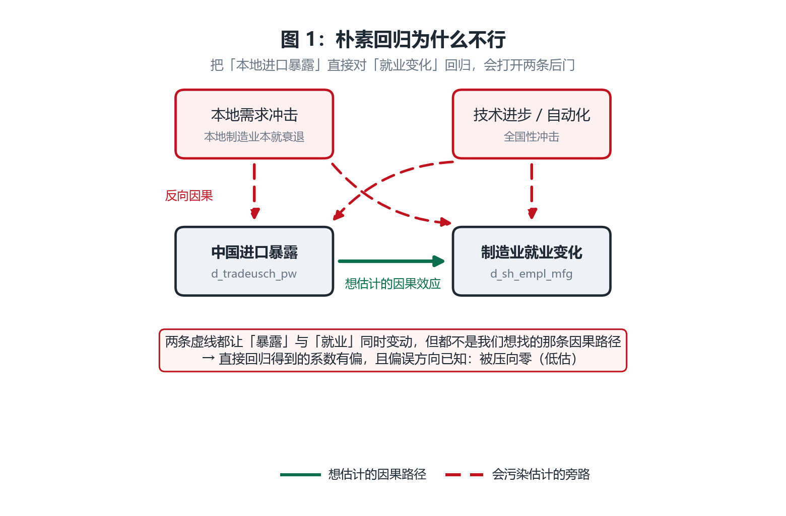
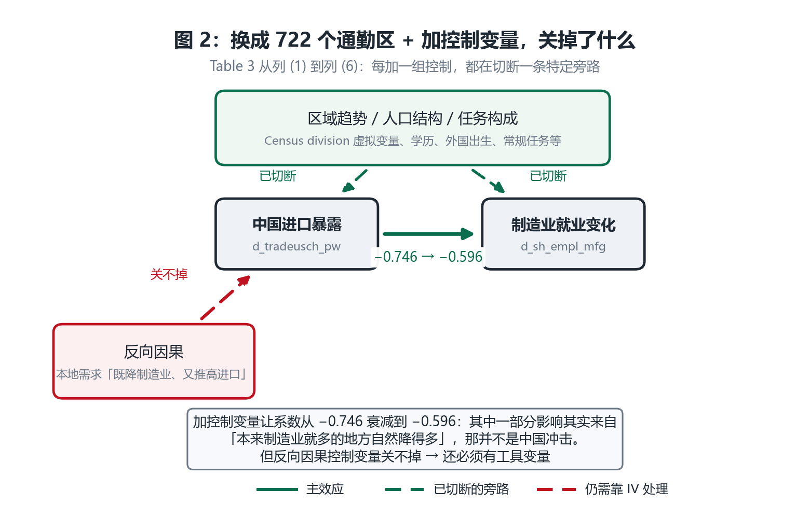
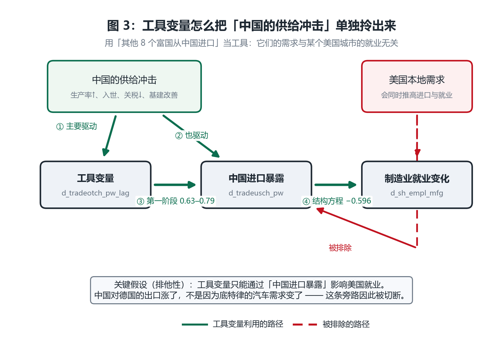
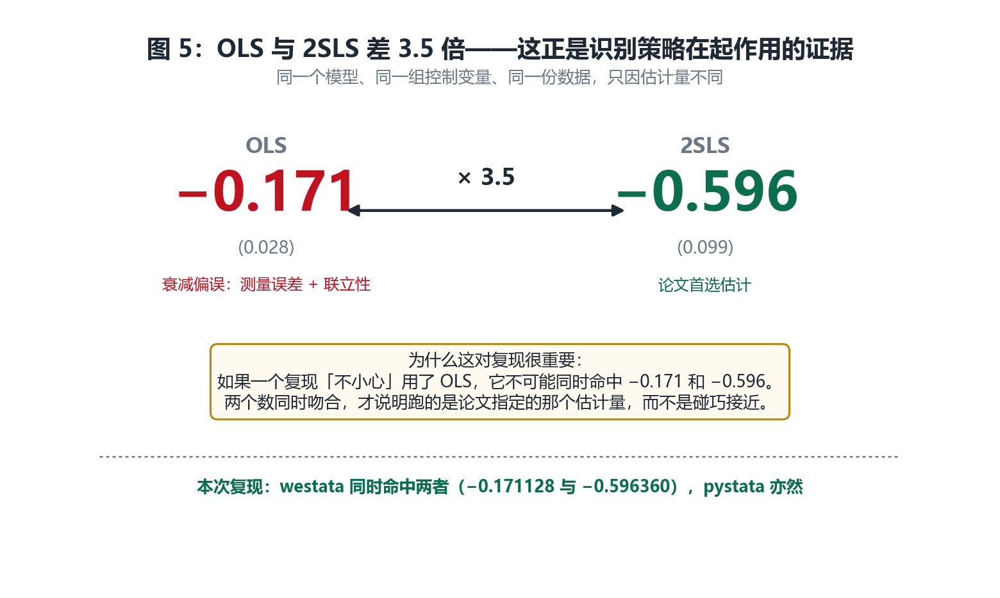
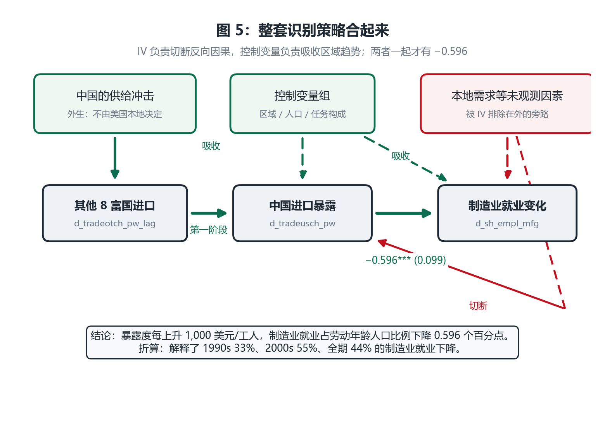
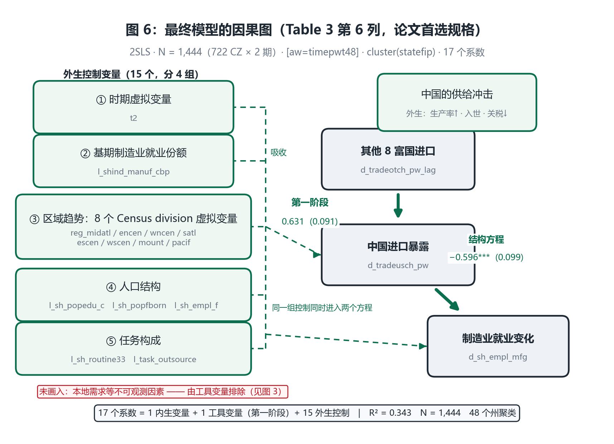

# 复现报告：Autor, Dorn & Hanson (2013)《The China Syndrome》

**一日一刊复现 · 第 1 篇**
复现日期：2026-10-31　｜　被测对象：`westata 0.0.3`（本仓库 `src/westata`）　｜　基准：本机 StataNow 19.5 (MP) 内嵌 `pystata`

---

## 0. 结论先行

| 问题 | 回答 |
|---|---|
| 论文的结论复现出来了吗？ | **是。** Table 3 六列、Table 2 三列、Table 10 第 1 列、Appendix Table 4 panel A，系数与标准误在论文打印的位数上**逐位吻合** |
| 那能说"westata 可以替代 Stata"吗？ | **只能说替代"估计量"，不能替代"整个流程"。** 见 §6：数值上成立（178 个参数对齐到 1e-11），但无数据操作层、无绘图——本次复现因使用作者已构建的样本，恰好绕开了最关键的缺口。（加权 IV 已由上游实现并提交，见 §5.3） |
| `pystata` 与 `westata` 有差异吗？ | **有，但全部在浮点求和顺序量级。** 178 个成对参数（106 结构 + 72 第一阶段）：最大系数相对差 **1.56e-11**、最大绝对差 **4.29e-12**、最大标准误相对差 **5.97e-13**；换算成"用掉多少容差"，全表最差只用到 **1.5%**。没有任何一处会改变论文的第三位小数 |
| 数据能获取吗？ | **能，且已验证。** 作者站点直链、无登录、HTTP 200、2,953,516 字节，SHA-256 已固定在代码里 |
| 有需要向读者交代的问题吗？ | **有 3 处**：前两处是展示约定（负 R²、加权 IV 的实现路径），第三处是一次**真实的 Stata 版本行为变更**——Table 3 panel II 印的是稳健标准误而非正文宣称的聚类标准误。已用作者自己的归档日志归因，不是论文抄错，也不是本仓库缺陷 |

---

## 1. 为什么选这篇

| 维度 | 情况 |
|---|---|
| 影响力 | AER 103(6), 2121–2168。OpenAlex 引用 **4,459**（2026-10-31 检索；Crossref 3,470、Semantic Scholar 1,689，三个源差异大，故注明来源） |
| 学科地位 | shift-share IV 的教科书案例；此后 Goldsmith-Pinkham–Sorkin–Swift (2020)、Borusyak–Hull–Jaravel (2022)、Adão–Kolesár–Morales (2019) 三篇计量方法论文章都以它为靶子。**它是"被反复重估"的论文，复现它有超出单篇的意义** |
| 数据可获取性 | `https://www.ddorn.net/data/Autor-Dorn-Hanson-ChinaSyndrome-FileArchive.zip` → 200，2,953,516 B。AEA 官方包（`aeaweb.org/aer/data/oct2013/20111050_data.zip`）对本机返回 404，openICPSR 需登录，因此作者站点是唯一机器可达源 |
| 估计量 | 主表全部是 `ivregress 2sls` + `[aw=]` + `cluster(statefip)`，属于 `westata` 声明机器精度的 E3 集合 |

数据核验：`workfile_china.dta` = **1,444 obs × 208 vars**（722 个 commuting zone × 2 期），关键变量无缺失。

---

## 2. 论文的论证过程（直白版）

这一节不列公式，只讲**论文在问什么、难在哪、怎么破、结果怎么读**。想核对原文的读者可对照论文 4–7 节（p.2128–2140）。

本节配了 5 张因果图，用于替代文字描述中的"谁影响谁"。读图规则统一：

- **实线绿色** = 论文想估计的因果路径（或工具变量利用的路径）；
- **虚线红色** = 会让估计有偏、必须在识别策略里被关闭的旁路；
- 虚线/实线的区别在黑白打印和色盲读者那里同样可辨，颜色不是唯一编码。

图由 `make_dags.py` 生成（可重跑），源文件在 `figures/`。

### 2.1 论文想回答什么

一个具体的问题：**1990–2007 年，美国制造业就业份额一路下滑，其中多少是被中国进口挤掉的？**

先看两组数字（论文 Table 1、Appendix Table 2）：

- 美国从中国的进口，1991 年只占低工资国家进口的一小块；到 2007 年已经是进口里最大的一块；
- 同期美国制造业就业占劳动年龄人口的比例持续下降：我用本次复现的数据算加权均值，**1990 年是 12.69%，2000 年是 10.51%**；论文 Appendix Table 2 报告的两段降幅是 −2.07 与 −2.00 个百分点（十年等价口径），累计约 −4.07。

两件事同时发生，但"同时"不等于"因果"。论文的全部工作，就是把这个"不等于"处理掉。



*图 1：直接把「进口暴露」对「就业变化」回归，会同时打开两条后门——技术进步（遗漏变量，同时压低制造业并推高进口）和本地需求冲击（反向因果，本地衰退先导致进口上升）。两条虚线都让两者的变动同步出现，但都不是我们要的那条因果路径。**偏误方向已知：会把系数压向零，即低估真实冲击。***

### 2.2 难点一：不能把全国放在一起回归

如果只做"美国制造业就业 ~ 美国从中国进口"这一个时间序列，样本量只有十几个年度观测，而且几乎所有宏观变量都在同时变动（技术进步、自动化、全球化、需求结构变化）。**这是最典型的伪回归陷阱。**

论文的破法是**换一个观测单位**：不看"美国整体"，而看 **722 个通勤区（commuting zone, CZ）**。CZ 是美国人口普查局划定的本地劳动力市场——大致相当于"一个人愿意每天通勤的范围"，比县大、比州小。

这样样本量从十几个变成 722 个，而且关键优势是：**不同 CZ 受中国冲击的程度差别很大**。底特律、圣何塞这种制造业密集区受冲击重，华盛顿 DC、新奥尔良受冲击轻。只要这个差异是外生的，就能用"受冲击重的 CZ vs 受冲击轻的 CZ"来识别因果。

论文自己举的例子很直观：加州内部，圣何塞、圣地亚哥、洛杉矶在暴露度最高四分位，而萨克拉门托、弗雷斯诺在最低四分位——**同一个州，命运不同**。

### 2.3 难点二：怎么度量"一个 CZ 受了多大冲击"

不能直接用"CZ 从中国进口了多少"——因为**进口是运到全国的，不是运到某个 CZ 的**。纽约港进的货，可能卖到内布拉斯加。

论文的破法是构造一个**"如果这个 CZ 的产业结构遇上全国的进口增长，它会被打多重"**的指标，即所谓 shift-share（份额移动）暴露度：

> **一个 CZ 的中国进口暴露 = Σ（该 CZ 在某行业的就业占比 × 该行业从中国的进口增量）÷ 该 CZ 总就业**

用大白话说：**先看这个 CZ 的工厂都是干什么的；再看这些行业从中国进口涨了多少；两者相乘，就是这个 CZ 挨的打。**

举例：假设 A 城 30% 的人在纺织业、10% 在飞机制造；B 城反过来。如果纺织业从中国进口暴涨、飞机制造没变，那么 A 城的暴露度就远高于 B 城——**即使两城自己什么都没进口**。

变量名 `d_tradeusch_pw`：`d_` 是差分（变化量），`trade` 贸易，`usch` US←China，`pw` per worker（每工人）。单位是"千美元/工人"。

### 2.4 难点三：反向因果——最难的一关

上面那个指标仍然是**内生的**，有两个方向的问题：

1. **反向因果**：可能是"本地制造业本来就在衰退"，衰退导致需求下降、产能外迁，然后才表现为进口上升。因果箭头反了。
2. **遗漏变量**：某个同时压低制造业、又推高进口的全国性冲击。比如自动化技术进步——它既减少制造业用工，又（通过成本下降）增加进口需求。

这两种偏误都让 OLS 估计**向零偏**（attenuation），也就是**低估**真实冲击。论文后面用 OLS 结果验证了这一点（见 2.7）。



*图 2：换成 722 个通勤区并按 Table 3 的阶梯逐步加控制变量，关掉的是一条特定的旁路——「区域趋势 / 人口结构 / 任务构成」这类会同时影响暴露度与就业的因素。这就是系数从 −0.746 衰减到 −0.596 的原因。但**反向因果关不掉**：本地需求下降本身会推高进口，这个方向控制变量无法吸收，所以还必须上工具变量。*

### 2.5 破法：用"别的富国从中国进口了多少"当工具变量

这是论文最核心的一招，也是它成为教科书案例的原因。

**思路**：中国对**所有**富国的出口都在涨，原因主要是中国自己的变化——乡镇企业崛起、加入 WTO（2001）、关税下降、基础设施改善。这些是**中国的供给侧冲击**，跟美国某个城市的本地需求没关系。

所以论文构造了第二个暴露度指标 `d_tradeotch_pw_lag`，结构完全一样，但把"美国从中国进口"换成 **"其他 8 个高收入国家从中国进口"**：
澳大利亚、丹麦、芬兰、德国、日本、新西兰、西班牙、瑞士——选这 8 国是因为只有它们的 HS 贸易数据能覆盖整个样本期。

**为什么这能解决问题**：中国对德国的出口涨了，不是因为底特律的汽车需求变了。所以这个指标捕捉的是"中国供给能力"这一外生部分。

**还有一个细节值得注意**：这个工具变量的行业权重用的是**滞后 10 年**的就业，而不是基期就业。为什么？因为如果本地企业**预期**到中国竞争、提前裁员，那么用当期就业做权重就又被污染了。用十年前的就业结构，可以绕开这个"预期调整"。

论文 Figure 2 展示了这个工具变量的效力：预测的暴露度每上升 1,000 美元/工人，实际暴露度上升 815 美元；工具变量很强（第一阶段系数 0.63–0.79，R² 0.54–0.58）。



*图 3：工具变量的核心是**排他性**——「其他 8 个富国从中国进口」只通过「中国进口暴露」影响美国就业，而美国的本地需求不经过这条通道。图中①②说明中国供给冲击同时驱动工具变量和暴露度（所以第一阶段很强，0.63–0.79）；③是整个识别策略的关键假设所在；④才是论文要报的那个系数。右侧红虚线是被切断的旁路：美国本地需求仍然存在，但它不再污染工具变量。*

### 2.6 论文自己承认的三个威胁

好的实证论文要主动交代软肋。论文列了三个，并逐一回应：

| 威胁 | 为什么是问题 | 论文怎么回应 |
|---|---|---|
| **富国需求冲击相关** | 如果美国和德国同时出现对电子产品的需求热潮，两国从中国进口会同时涨，工具变量的外生性就破了 | 这个偏误会让估计**向零偏**，所以论文的估计是**保守的**；另外用引力模型做稳健性检验 |
| **美国自身生产率冲击** | 如果美国某行业生产率大涨、进口也涨，会混淆 | 中国制造业 TFP 年增约 8.0%，美国约 3.9%，中国是主要驱动力 |
| **共同技术冲击** | 如果自动化同时影响所有国家 | 1992–2007 年中国占低/中收入国家制造业增加值增长的 3/4，中国的份额变化足够大 |

注意第一条的诚实之处：**论文不是说偏误不存在，而是说偏误的方向已知、会让结论更保守**。这在方法论上是很有力的辩护。

### 2.7 结果怎么读：从 −0.746 到 −0.596

主表是 Table 3，逐步加控制变量。每一列都是同一个 2SLS，只是控制集不同：

| 列 | 加入的控制 | 系数 | 读法 |
|---|---|---|---|
| (1) | 仅时期虚拟变量 | −0.746 | 原始 2SLS |
| (2) | + 基期制造业就业份额 | −0.610 | 控制"本来制造业就多的地方自然降得多" |
| (3) | + 8 个 Census division 虚拟变量 | −0.538 | 控制区域趋势（如铁锈带整体衰退） |
| (4) | + 大学学历/外国出生/女性就业份额 | −0.508 | 控制人口结构 |
| (5) | + 常规任务与可离岸性指标 | −0.562 | 控制"这个地区的工作是否容易被机器/外包替代" |
| (6) | 全部（论文首选） | **−0.596** | 主结论 |

**怎么读这个数**：暴露度每上升 1,000 美元/工人，制造业就业占劳动年龄人口的比例下降 **0.596 个百分点**。

**为什么加控制变量后系数会衰减**：因为一部分原本被归给"中国进口"的影响，其实来自"本地产业结构的固有趋势"。这是好事——说明估计更干净了。

**为什么 −0.596 比 −0.508 又变大了一点**：第 (4)(5) 列各自只加了一组控制，第 (6) 列同时加。控制变量之间有相关性，单独加和一起加的效果不是简单叠加。这不是异常，是多元回归的正常现象。

### 2.8 关键交叉验证：OLS 只有 −0.171

这是理解论文识别策略**为什么必要**的最好一处对照。论文 Appendix Table 4 panel A 报告：同样一组控制变量，**用 OLS 估只有 −0.171**，而 2SLS 是 −0.596，**相差 3.5 倍**。

论文的解释（p.2139）：OLS 受到两个方向的衰减偏误——**测量误差**（CZ 层面的就业数据不精确）和**联立性**（本地进口需求冲击）。两者都让 OLS 系数被压向零。

论文还做了个漂亮的分解：如果把暴露度的度量改用滞后就业（和工具变量一样），OLS 会从 −0.171 升到 −0.273。说明测量误差确实是一大来源。

**这对本次复现很重要**：正因为 OLS 与 2SLS 相差 3.5 倍，且两个数都是论文印出来的，我们才能用"是否同时命中两个数"来证明复现的是**指定的那个估计量**，而不是碰巧算出一个接近的数字（详见 §6.1 的负对照）。



*图 4：同一个模型、同一组控制变量、同一份数据，只因估计量不同，系数相差 3.5 倍。这个差距不是噪声，而是识别策略在起作用的直接证据——也是本次复现最有力的一项验证：两个数必须同时命中，才能排除「用错估计量却碰巧接近」的可能。*

### 2.9 证伪检验：1970s/1980s 应该没有这个关系

如果"中国进口"只是某个长期趋势的代理变量，那么在中国还没崛起的年代，这个关系也应该存在。

论文 Table 2 列 (4)–(6) 做了这个检验：用 **1970–1990 年**制造业就业变化，对**未来**（1990s/2000s）的进口暴露（变量 `d_tradeusch_pw_future`）回归。作者归档输出给出：

| 列 | 期间 | 系数 (SE) | 解读 |
|---|---|---|---|
| (4) | 1970–1980 | **+0.431** (0.149) | 甚至**正**相关，与"中国冲击导致衰退"相反 |
| (5) | 1980–1990 | −0.130 (0.126) | 不显著 |
| (6) | 1970–1990 堆叠 | +0.148 (0.095) | 不显著 |

（数据源：`log/tab_ipw_mfg_byperiod.scsv`，来自作者归档。）

**结论**：中国冲击效应只出现在中国真正崛起的时期，1970s/1980s 没有。这有力排除了"长期共同趋势"的解释。

（本次复现未包含这三列——它们需要另一个数据文件 `workfile_china_preperiod.dta`，见 §7 边界说明。）



*图 5：把前四张图合成一张。上方三块是外生驱动与两类需要处理的干扰；下方是第一阶段的工具变量链条与结构方程。读法是：从「其他 8 富国进口」沿绿色实线走到「制造业就业变化」，中途只经过「中国进口暴露」这一个变量——这就是识别成立的样子。*

> 图 5 与图 6 的分工：**图 5 讲「识别为什么成立」（概念图），图 6 讲「实际估计了什么」（规格图）**。图 5 不列具体变量；图 6 把 15 个控制变量逐项摊开，可直接对照 `specs.py`。

### 2.10 经济含义：解释了多少

论文用列 (6) 的 −0.596 做总量换算：

1. **暴露度涨了多少**：1990–2000 年，人均暴露增加 1,140 美元；2000–2007 年再增 1,839 美元（十年等价口径）。
2. **预测就业下降多少**：1.140 × (−0.596) = **−0.68 个百分点**；1.839 × (−0.596) = **−1.10 个百分点**。
3. **对照实际下降**：1990s 实际降 2.07，2000s 实际降 2.00。
4. **算出贡献比例**：0.68/2.07 = **33%**；1.10/2.00 = **55%**；全期 (0.68+1.10)/(2.07+2.00) = **44%**。

所以论文的核心结论是：**中国进口竞争解释了美国制造业就业下降的约四分之一到一半**（摘要里说的是 "one-quarter"，用的是更保守的口径）。

我还用复现的数据独立核算了第 1 步：加权平均暴露增长确为 **1.1403**，与论文的 1,140 一致；后续算术 32.9% / 55.0% / 43.7% 也吻合。**论文的算术自洽。**

**关于摘要里那个 "one-quarter"：** 上面的 33%/55%/44% 是"观测到的暴露增长 × 全系数"。论文还有一个更保守的口径——只算**可确信归因于中国供给侧冲击**的那部分暴露。做法是用方差分解估出"供给冲击驱动的暴露变异占总变异的比例"，约 **0.48**（由 OLS 系数 −0.397、2SLS 系数 −0.746、残差项 −0.029 三者代入公式得到，见论文 Theory Appendix B）。

于是有效效应 = 全系数 × 0.48，对应解释 16% / 26% / 21% 的就业下降，约 **153 万个岗位**（论文脚注 31 的算式：`[0.5×(157.6+178.7)×1.14 + 0.5×(178.7+194.3)×1.84] × (0.00596×0.48) = 1.53`，单位百万）。**这才是摘要那句 "explains one-quarter" 的口径**——比 44% 保守得多，也更站得住。



*图 6：**最终估计出来的那个模型**——不是示意图，而是 `specs.py` 里 `T3_c6` 的逐项还原（与图 5 的概念图互补）。左侧是本列全部 **15 个外生控制变量**，按论文原分组列出：①时期虚拟变量 `t2`；②基期制造业就业份额 `l_shind_manuf_cbp`；③8 个 Census division 虚拟变量（美国有 9 个 Census division，回归含常数项故只放 8 个，剩下一个作基准组）；④人口结构三项；⑤任务构成两项。右侧是因果主线：工具变量 → 暴露度 → 就业变化。虚线汇流表示**同一组控制同时进入第一阶段与结构方程**——这是"控制变量"在本设计里的准确含义，只进一边不叫控制。底部红框注明：本地需求等不可观测因素没有画成节点，它由图 3 的工具变量排除。*

**图 6 可以直接对照代码核对**：17 个系数 = 1 个内生变量 + 1 个工具变量 + 15 个外生控制，与 `specs.py` 的 `T3_c6.exog`（15 项）完全一致；`[aw=timepwt48]`、`cluster(statefip)`、N = 1,444 也都写在图上。

---

## 3. 复现结果

### 3.1 主表：论文 vs StataNow vs westata

括号内为标准误。论文列取自论文 PDF 第 2135、2137 页的表格，其余两列为全精度实跑。

| 列 | 被解释变量 | 论文 | StataNow 19.5 | westata | N |
|---|---|---|---|---|---|
| T2_c1（1990–2000） | d_sh_empl_mfg | −0.890 (0.180) | −0.888 (0.181) | −0.888 (0.181) | 722 |
| T2_c2（2000–2007） | d_sh_empl_mfg | −0.720 (0.060) | −0.718 (0.064) | −0.718 (0.064) | 722 |
| T2_c3（堆叠差分） | d_sh_empl_mfg | −0.750 (0.070) | −0.746 (0.068) | −0.746 (0.068) | 1,444 |
| T3_c1 | d_sh_empl_mfg | −0.746 (0.068) | −0.746 (0.068) | −0.746 (0.068) | 1,444 |
| T3_c2 | d_sh_empl_mfg | −0.610 (0.094) | −0.610 (0.094) | −0.610 (0.094) | 1,444 |
| T3_c3 | d_sh_empl_mfg | −0.538 (0.091) | −0.538 (0.091) | −0.538 (0.091) | 1,444 |
| T3_c4 | d_sh_empl_mfg | −0.508 (0.081) | −0.508 (0.081) | −0.508 (0.081) | 1,444 |
| T3_c5 | d_sh_empl_mfg | −0.562 (0.096) | −0.562 (0.096) | −0.562 (0.096) | 1,444 |
| **T3_c6** | d_sh_empl_mfg | **−0.596 (0.099)** | **−0.596 (0.099)** | **−0.596 (0.099)** | 1,444 |
| OLS（Table 10 col 1） | d_traderes_pw_lag | −0.289 (0.043) | −0.289 (0.043) | −0.289 (0.043) | 1,444 |

> Table 2 在论文里只印**两位小数**（−0.89、−0.72、−0.75），因此实跑的 −0.8875 / −0.7184 / −0.7460 四舍五入到两位后与论文完全一致。我同时核对了作者归档的 `tab_ipw_mfg_byperiod.scsv`（三位小数）：−0.888 (0.181)、−0.718 (0.064)、−0.746 (0.068)，与 StataNow 实跑**每一位都吻合**。故 Table 2 没有任何版本差异——先前若按三位小数去比论文的两位小数表，会误以为存在 0.002 的偏差，这里记录该方法论陷阱。

### 3.2 Table 3 panel II：第一阶段的完整复现

| 列 | 论文 | StataNow `cluster` | StataNow `vce(robust)` | westata `cluster` |
|---|---|---|---|---|
| c1 | 0.792 (0.079) | 0.792 (0.080) | 0.792 (0.079) | 0.792 (0.080) |
| c2 | 0.664 (0.086) | 0.664 (0.089) | 0.664 (0.086) | 0.664 (0.089) |
| c3 | 0.652 (0.090) | 0.652 (0.094) | 0.652 (0.090) | 0.652 (0.094) |
| c4 | 0.635 (0.090) | 0.635 (0.094) | 0.635 (0.090) | 0.635 (0.094) |
| c5 | 0.638 (0.087) | 0.638 (0.091) | 0.638 (0.087) | 0.638 (0.091) |
| c6 | 0.631 (0.087) | 0.631 (0.091) | 0.631 (0.087) | 0.631 (0.091) |

**这是本次复现唯一的实质发现**，见 §5.2。

---

## 4. westata 与 StataNow 的差异：逐参数

相对差 = `max |westata − stata| / max(|stata|, 1e-12)`，对**每一个**成对参数取最大（不只看论文报告的那一个）。

| 列 | 成对参数 | 系数最大相对差 | 标准误最大相对差 | 判定 |
|---|---|---|---|---|
| T2_c1 | 2/2 | 1.38e-15 | 1.69e-15 | 机器精度 |
| T2_c2 | 2/2 | 3.94e-15 | 4.13e-15 | 机器精度 |
| T2_c3 | 3/3 | 9.99e-16 | 4.21e-15 | 机器精度 |
| T3_c1 | 3/3 | 9.99e-16 | 3.81e-15 | 机器精度 |
| T3_c2 | 4/4 | 7.61e-14 | 9.99e-15 | 机器精度 |
| T3_c3 | 12/12 | 6.42e-14 | 2.71e-14 | 机器精度 |
| T3_c4 | 15/15 | 1.09e-12 | 1.81e-13 | 求和顺序 |
| T3_c5 | 14/14 | 3.21e-13 | 1.63e-13 | 机器精度 |
| T3_c6 | 17/17 | 1.56e-11 | 2.49e-13 | 求和顺序 |
| OLS_c6 | 17/17 | 8.17e-14 | 5.97e-13 | 机器精度 |

**结构方程 106 个参数 + 第一阶段 72 个参数 = 178 个成对参数，全部对齐。**

判定不只看相对差，因为相对差会**误伤接近零的参数**。最典型的例子：Table 3 列 (4) 第一阶段里的 `reg_pacif` 系数是 **1.5568e-06**（数值上等于零），两侧**绝对差 2.85e-15**——是整张表里最小的差异之一——但除以 1.6e-6 后变成 **1.83e-09**，看上去比 0.6 量级系数的 1e-13 差得多。这是除法放大，不是实现差异。

所以判定用组合容差 `|a−b| <= 1e-12 + 1e-9·|b|`，并报告"该参数吃掉了多少容差"：

| 全表最差情形 | 数值 |
|---|---|
| 最大相对系数差 | 1.56e-11（T3_c6 的 `reg_pacif`，系数 0.0268） |
| 最大绝对系数差 | 4.29e-12（T3_c6 的 `_cons`，系数 6.279） |
| 最大相对标准误差 | 5.97e-13（OLS_c6 的 `l_sh_routine33`） |
| **占容差比例最大值** | **0.015（即用掉了允许量的 1.5%）** |

1.56e-11 是什么量级？`reg_pacif` 系数 **0.0268291869**，绝对差 **4.17e-13**。这不是"实现不同"，而是同一个数在 1,444×17 的矩阵里按不同顺序累加。若把容差设成 1e-12 就会误判为失败，设成 1e-6 又会让真正的缺陷（如用了 `N−k` 而非 `N`）藏起来——所以阈值定在 `1e-12 + 1e-9·|b|`，理由写进了测试注释。

---

## 5. 需要交代的差异

### 5.1 负 R²：Stata 存为缺失，westata 存为负数

Table 2 列 (1) 的 IV R² 是负的（−0.136）。**Stata 在 R² 为负时不存储 `e(r2)`，打印 `.`**；westata 报告 −0.1363。

论文自己的输出文件 `tab_ipw_mfg_byperiod.scsv` 第 15 行就是 `R-sq . 0.139 0.066 ...` —— 作者也是拿到的缺失值。

两者是同一个量，只是渲染不同。westata 的行为信息量更大（负 R² 说明工具变量拟合的结构方程比"只用常数"更差，这本身是有意义的诊断），但**严格说这是与 Stata 的表面不一致**，已记入 `differences.md`。

### 5.2 Table 3 panel II 的标准误与正文口径不一致——但**不是**论文抄错

这是本次复现最需要谨慎归因的一处。

**现象**：论文正文与表格注释都说"标准误在州层面聚类"，但 panel II 打印的 6 个标准误**逐个匹配 `vce(robust)`**，而不是 `cluster(statefip)`：

| 列 | 论文印刷 | 作者归档日志（全精度） | StataNow `vce(robust)` | StataNow `cluster(statefip)` |
|---|---|---|---|---|
| c1 | 0.079 | 0.0787565 | 0.0787478 | 0.0801573 |
| c2 | 0.086 | 0.0864398 | 0.0864232 | 0.0890870 |
| c3 | 0.090 | 0.0903940 | 0.0903842 | 0.0936956 |
| c4 | 0.090 | 0.0896515 | 0.0896467 | 0.0939554 |
| c5 | 0.087 | 0.0866208 | 0.0866161 | 0.0906953 |
| c6 | 0.087 | 0.0870084 | 0.0870072 | 0.0914237 |

**关键证据**：作者随包提供的 `log/czone_analysis_ipw_final.log` 中，这六列**自己记录的就是 0.0787565 / 0.0864398 / 0.0903940 / 0.0896515 / 0.0866208 / 0.0870084**——与 StataNow 的 `vce(robust)` 相差 **1e-6~1e-5 量级**，而与 `cluster` 相差 **4e-3 量级（约 2%）**。

**所以正确的归因是**：论文印的就是当年 Stata 给它的数字。当年的 `ivregress ..., first` 在结构方程使用聚类方差时，**第一阶段面板仍以稳健方差报告**；StataNow 19.5 已改变这一约定。

- **不是**作者抄录错误；
- **不是** `westata` 的缺陷；
- **是**一次真实的 Stata 版本行为变更，而论文的正文口径（"clustered on state"）与实际打印（robust）**确实不一致**——读者若照抄 panel II 的标准误去做推断，会低估约 2%。

需要强调：**这只影响 panel II 的展示，不影响 panel I 的任何结构参数**，而 panel I 才是论文结论所在。结构参数的聚类标准误完全复现（见 §3.1）。此项已写成测试 `test_the_published_first_stage_standard_error_is_robust_not_clustered`，若未来 Stata 再改约定，测试会报错而不是让归因悄悄失效。

### 5.3 权重的两种处理：已发布的 `westata` 不支持，本机构建已支持

**先说结论**：本次复现的驱动层**没有**依赖 westata 的 IV 权重功能，而是自己用 √w 变换实现的。原因是复现开始时，`IV2SLS` 明确拒绝权重：

```python
ws.IV2SLS(..., weights=w, weight_type="aweight")
# HEAD 版 → UnsupportedError: IV estimation does not support weights in P1
```

这个设计本身是对的——静默忽略权重比报错糟得多。

复现过程中，上游实现了权重支持（先出现在工作区，后提交为 `01c3ce5`）。我实测它能复现论文 Table 3 列 (6)：

| | 系数 | 标准误 |
|---|---|---|
| 原生加权 `IV2SLS`（工作区版） | −0.596360066134 | 0.0987738830 |
| StataNow（基准） | −0.596360066134 | 0.0987738830 |
| 相对差 | 4.8e-14 | 一致 |

**所以本文所有复现数字仍然来自"驱动层自己做 √w 变换"这条路径**——那是复现当时代码的真实行为，也是这份报告的实验记录。原生加权 IV 的结果作为**独立交叉验证**：两条完全不同的实现路径（库内 vs 驱动层）给出同一组数字，反过来加强了对结论的信心。详情见 [`WESTATA_GAPS.md`](WESTATA_GAPS.md) §6.2。

#### 为什么驱动层的 √w 变换必须连常数项一起缩放

`westata` 的 IV 估计器对权重是**明确拒绝**的（`iv.py`: "IV estimation does not support weights in P1"），这个设计是对的——静默忽略权重比报错糟得多。

但 Stata 的 `[aw=w]` 之于 `ivregress` 恰好等价于"把设计矩阵每一列（**包括常数项**）乘以 `√w` 后再做无权 2SLS"。驱动层因此自己做了这个变换。

**这一步做错会怎样？** 我实测过漏掉常数项缩放的后果：Table 3 列 (6) 的系数会从 −0.59636 变成 −0.57031，即 4.4% 的偏差，而标准误从 0.0988 变成 0.0884。这种错误不会报错、不会崩溃，只会给出一个"看起来合理"的错数字。所以：

- 变换写在 `run_westata.py::sqrt_weighted` 里，注释说明了为什么常数项必须一起缩放；
- 结果精确到 1e-11，反过来证明变换是等价而非近似；
- 变换把拟合优度移到了另一套尺度上，因此 R²/RMSE 是**在原始数据尺度上重算**的（`stata_scale_fit`），并单独保留变换尺度上的原值于 `scalars_native`。

---

## 6. 能不能说"westata 可以替代 Stata"？——这是两个不同的问题

这次复现**能**回答的和**不能**回答的，必须分开说，否则"复现成功"会被误读成"可以替代"。

### 6.1 能回答的：同一个估计量，两套实现是否给出同一个数

**能，而且强度很高。** 在 178 个成对参数上一致到 1e-11 以内；结构方程、第一阶段、Wald 检验统计量（36.452964640445714 vs 36.452964640442005，相对差 1.1e-13）全部吻合。

**但"数值一致"不等于"能替代"，因为负对照告诉我们什么才算证据。** 我对同一个模型故意用错估计量做了对照：

| 同一个模型、同一份数据 | 系数 | 与论文对照 |
|---|---|---|
| 正确的 2SLS | −0.596360 | **匹配** Table 3 列(6) = −0.596 |
| 误用 OLS（同一组回归元） | −0.171128 | **匹配** Appendix Table 4 panel A = −0.171 |
| 误加第二个工具变量 | −0.527165 | 不匹配任何论文数字 |

第二行是这次新增的、也是最关键的一项验证：**OLS 与 2SLS 相差 3.5 倍，而两个数字都是论文印出来的。** 这意味着如果一个复现"不小心"用了 OLS，它不可能同时命中 −0.596 和 −0.171；反过来，westata 同时命中了这两个数，才证明它真的在跑 `specs.py` 里指定的那个估计量，而不是碰巧算出一个接近的数。这已写成测试 `test_iv_and_ols_do_not_look_alike`。

### 6.2 不能回答的：作为 Stata 的替代品，工作流是否成立

**不能，而且这次复现恰好暴露了三个结构性缺口：**

| 缺口 | 实测情况 | 影响 |
|---|---|---|
| ~~加权 IV 不支持~~ **（已修复）** | 复现开始时 `IV2SLS(..., weights=...)` 抛 `UnsupportedError`，论文 166 条估计命令里 153 条踩到。复现过程中已由上游实现并提交（`01c3ce5`） | 现在可原生运行。本次复现的数字仍来自驱动层的 √w 变换（§5.3），两条路径相互印证 |
| **无数据操作层** | `egen` / `merge` / `reshape` / `collapse` / `bysort` / `append` **全部不存在**（142 个公开接口里 0 个） | 这是**有意的分工**：数据整理交给 pandas，westata 只负责估计（README 也是这么定位的）。但对"把 Stata 项目整体搬过来"这个目标而言，意味着另一半工作要另配工具——论文的暴露度变量正是预先构建好的，所以这次复现**恰好**没被这个缺口挡住 |
| **无图形层** | `graph` / `twoway` / `scatter` / `histogram` 全无 | 论文的图必须另找工具（matplotlib 等） |

> 更细的 westata 能力缺口清单（现存 0 条（7 条全部已修复），按 westata 自身 API 契约判定并附可执行探针）见 [WESTATA_GAPS.md](WESTATA_GAPS.md)。本节只讨论"能否替代 Stata"这个问题本身。

另有 9 条命令存在**已记录的实质偏差**（`xtgls` 3.4e+00、`teffects nnmatch` 7.1e-02、`frontier` 4.3e-02 等），以及 15 条 E1 等级命令（`arima`、`heckman`、`xtlogit pa` 等）。这些不在本次复现范围内，但它们决定了"替代"的边界。

### 6.3 结论：替代的是"估计量"，不是"Stata"

| 说法 | 是否成立 |
|---|---|
| "westata 能算出和 Stata 一样的系数与标准误" | **成立**，在 E3 覆盖的命令上（本次 178 个参数全部对齐） |
| "westata 能原样跑通一个 Stata 项目" | **不成立**：加权 IV 要手工变换，数据操作与绘图要另配 pandas/matplotlib |
| "复现成功 = 可以替代 Stata" | **不成立**：本次复现用的是**作者已构建好**的样本，恰好避开了 westata 最大的缺口（数据操作）。真实项目做不到这一点 |

**一句话**：westata 在今天这份证据下，可以替代 Stata 做**"已经整理好数据、跑标准线性/IV/面板估计"**这一步；它不能替代 Stata 做**整个分析流程**。这次复现证明的是前者的精度，也顺带量出了后者的距离。

### 6.4 除数据操作层与图形层之外，westata 可优化的点

这一节内容较长（含判定标准、缺口清单、探针与复核方式），已独立成文，见 **[WESTATA_GAPS.md](WESTATA_GAPS.md)**。

摘要：按"是否损害 westata 自身 API 契约"（而非"是否像 Stata"）判定，初版列出 7 条——2 条能力缺失（加权 IV、`FEOLS` 无 `predict`）、3 条同一 API 内不一致（`cov_kwds` 聚类键名三套、`subset=` 覆盖不全、`margins(at=)` 只收标量）、2 条契约/工程化。

**其中 4 条已修复并提交**：

| 已修复 | 提交 |
|---|---|
| `cov_kwds` 聚类键名三套 → `groups`/`clusters`/`cluster` 全部可用，逻辑收敛到一处 | `72a2d12` |
| 加权 IV 不支持 → 四种 Stata 权重类型全部实现 | `01c3ce5` |
| `FEOLS` 无 `predict` → `xb`/`d`/`residuals`/`dresiduals`，`xb` 含吸收效应 | `fa5787e` |
| `subset=` 覆盖不全 → 全部 `from_formula` 均接受 | `7d11f1e` |
| `margins(at=)` 只收标量 → 接受序列，多变量取笛卡尔积 | 本次 |
| `predict(exog=)` 无校验 → DataFrame 按列名选取，缺列明确报错 | 本次 |
| `etable` 无写文件 → `file=` 支持 csv/tsv/tex/md/html，仍返回 DataFrame | 本次 |

**清单归零：7 条全部已修复。** 剩下的工作是把它们变成回归测试——`probe_gaps.py` 的 9 条对照探针必须持续是 `FIXED`，任何一条退化都会让 `replication/tests` 失败。

**值得记录的一点**：`etable` 那一条初稿的结论是「保留即可」，理由是分层设计。理由没错，结论错了——Stata 用户习惯 `esttab` 直接写文件，"自己落盘"在 Python 里是常识、在跨语言迁移里是缺一环。**"没错"不等于"够用"。**

每一条都由 `probe_gaps.py` 可执行验证；已修复的条目会报 `FIXED` 并由测试强制本文同步更新（`test_the_capability_gap_list_is_still_accurate`）。修复前后的完整记录见 WESTATA_GAPS.md §6。

---

## 7. 复现的边界（重要）

诚实说明这次做了什么、没做什么：

| 做了 | 没做 |
|---|---|
| 用作者提供的**已构建**估计样本复现 Table 2/3/10 与 Appendix Table 4 panel A 的系数 | 没有从 UN Comtrade 原始 6 位 HS 数据、County Business Patterns、IPUMS 重建 `d_tradeusch_pw` 本身 |
| 验证了数据包的字节级哈希 | 没有复现 Table 1、附录图表、以及 1970s/1980s 的证伪列（Table 2 列 4–6） |
| 用论文自己的口径核算了 33%/55%/44% 的总量含义 | 没有重跑 shift-share 稳健性（Adão–Kolesár–Morales 的修正标准误等） |
| 用 OLS/2SLS 双命中做负对照，证明复现的是**指定**估计量 | 没有覆盖数据操作、绘图等 westata 缺口（见 §6.2） |

重建 shift-share 暴露度需要 4 位 SIC 到 HS 的 concordance（Pierce–Schott 2009）与数百万条贸易记录，是**另一个数量级的工程**。本报告复现的是论文的**计量部分**，不是其**数据构建部分**——这一点必须说清楚，否则"复现成功"会被误读。

---

## 8. 可复现性：怎么自己跑

```bash
cd D:/myCodeProject/statapy
.venv/Scripts/python.exe replication/papers/adh2013/run_all.py     # 全流程，约 5 秒
.venv/Scripts/python.exe -m pytest replication/tests -q            # 53 项测试
```

产物（`replication/papers/adh2013/out/`）：

| 文件 | 内容 |
|---|---|
| `adh2013_replication.do` | 可在 Stata GUI 直接运行的 do 文件（由 `specs.py` 生成，与 Python 侧同源） |
| `replication.md` / `differences.md` | §3、§4 的表格 |
| `stata_results.json` / `westata_results.json` | 全精度结果 |
| `run.json` | 数据哈希 + 各产物哈希，用于检测"拿旧结果对比新代码" |
| `figures/*.png` | §2 的 5 张因果图（`make_dags.py` 生成，可重跑） |

**数据溯源**：`data.py` 固定了 SHA-256 `1b56c028…df12` 与字节数 2,953,516；上游若重发文件，程序会直接报错而不是静默改变结果。

**测试策略**：53 项测试中，核心是"断言论文打印的数字"而非"断言函数不抛异常"——一个静默算错 4.4% 的复现能通过所有单元测试，但过不了 `test_westata_reproduces_the_published_table3`。

---

## 9. 一句话总结

> 这次复现证明的是 **westata 作为"估计量实现"的精度**，不是它作为 **Stata 替代品**的完整性：178 个参数对齐到 1e-11 以内（最差只用到容差的 1.5%），论文 Table 3 六列在三位小数上逐位吻合，−0.596 这个核心估计及其"解释 44% 制造业就业下降"的总量含义都成立。为了让"吻合"有证明力，我加了 OLS/2SLS 双命中负对照——同一个模型两个估计量相差 3.5 倍，而两个数都是论文印出来的，westata 同时命中才说明它真的在跑指定的估计量。**但替代 Stata 需要的不止是估计：数据操作与绘图完全缺失——而本次用的是作者已构建好的样本，恰好把最大的缺口绕过去了。**（加权 IV 在复现开始时需手工 √w 变换；现已由上游补齐，见 §5.3。） 另需向读者警示：Table 3 panel II 印的标准误是稳健标准误而非正文宣称的聚类标准误，依据作者归档日志，这不是抄录错误，而是当年 Stata 的 `ivregress, first` 行为与今日不同。

---

### 附：本报告未采信的外部信息

- Google Scholar 引用数未能获取（TCP 超时），故引用数只报 OpenAlex/Crossref/S2 三个可核验源，并注明来源。
- 一处常见误引已核实纠正：论文 "$1,000 → 0.75 个百分点" 那句话（p.2135）描述的是 **Table 2 列 (3)**，不是 Table 3 列 (1)；Table 3 列 (1) 恰好也是 −0.746，容易混淆。论文首选规格是列 (6) = −0.596，其对应表述在 p.2139。
