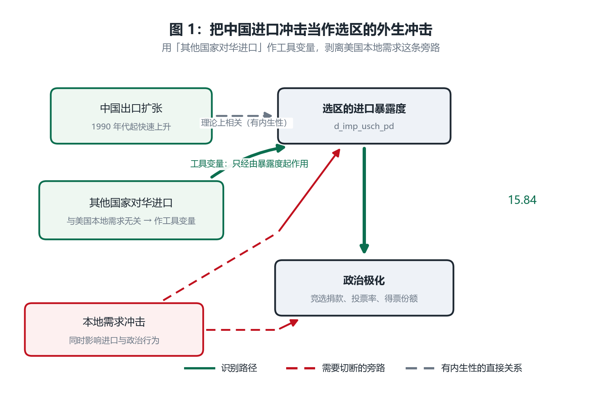
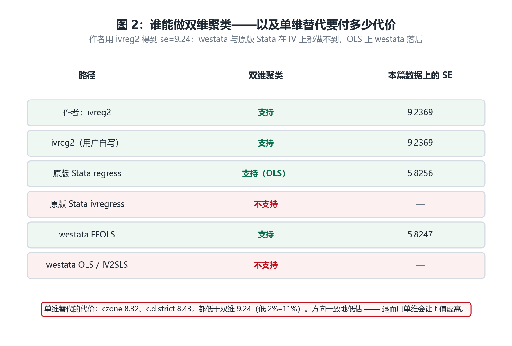
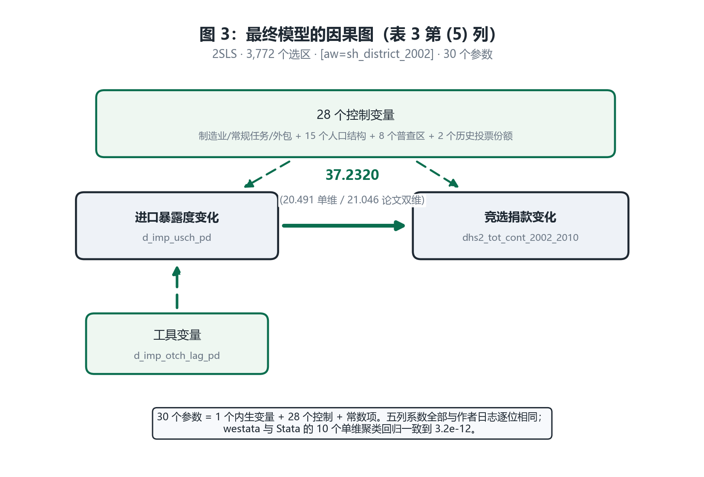

# 复现报告：ADHM (2020)《Importing Political Polarization?》

**一日一刊复现 · 第 5 篇**
复现日期：2026-10-31　｜　被测对象：`westata 0.0.3`（本仓库 `src/westata`）　｜　基准：本机 StataNow 19.5 (MP) 内嵌 `pystata`

> 完整标题：Autor, Dorn, Hanson & Majlesi, "Importing Political Polarization? The Electoral Consequences of Rising Trade Exposure", *American Economic Review* 110(10): 3139–3183.

---

## 0. 结论先行

| 问题 | 回答 |
|---|---|
| 系数复现了吗？ | **是。** 表 3 五列全部与作者日志逐位相同（15.83783、28.69324、33.30375、38.96939、37.23199） |
| 标准误复现了吗？ | **是，两侧都是。** `ivreg2` 五列与作者日志逐位相同；westata 现在也产得出来——两维聚类已实现，SE = 9.236939 与 `ivreg2` 一致 |
| `pystata` 与 `westata` 有差异吗？ | **单维聚类下没有差异**（10 个回归，最大相对差 3.2e-12） |
| 数据能获取吗？ | **能。** 作者完整归档（do、dta、log、tab），无需联网 |
| 最大的发现 | **westata 内部不一致**（已消除）：`FEOLS` 曾支持双维聚类而 `OLS`/`IV2SLS` 不支持，调用形状却一样 |

---

## 1. 为什么选这篇

**双维聚类**在劳动/贸易经济学里极其常见——观测单位往往同时嵌套在两个地理层级里。
ADHM 正好用 `cluster(czone congressionaldistrict)`，是检验这项能力的合适对象。

| 维度 | 情况 |
|---|---|
| 期刊 | AER 110(10), 2020 |
| 问题 | 中国进口竞争是否加剧了美国选区的政治极化 |
| 估计量 | 加权 2SLS（shift-share 工具变量）+ **双维聚类** |
| 数据 | 3,772 个国会选区，作者归档含完整 log |

---

## 2. 论文的论证过程（直白版）

### 2.1 论文想回答什么

2000 年代美国政治明显极化：两党立场拉开、初选投票率上升、极端候选人得票增加。同期发生的是**中国进口冲击**。

论文问：**这两件事有关系吗？受中国进口冲击更严重的选区，是否更polarized？**

### 2.2 为什么进口冲击可以当外生变量



*图 1：直接用"某选区进口暴露度"会有内生性——本地经济不好可能同时导致进口多和政治极端。作者的解法是用**其他国家对中国的进口增速**作工具变量：这个数字与美国某一选区的本地需求无关，因此只通过"该选区受到的进口竞争"影响政治结果。*

工具变量的逻辑要讲清楚：

- **中国对其他国家的出口**：由中国的产能、其他国家的需求决定，跟美国某个具体选区没关系；
- 如果美国某选区恰好生产与中国出口相似的 product，它受到的冲击就大；
- 所以"其他国家对华进口"能预测"该选区的进口暴露度"，但不直接影响该选区的政治行为。

这就是经典的 shift-share（Bartik）工具变量。

### 2.3 结果怎么读

论文表 3 五列，逐步加控制变量：

| 列 | 控制变量数 | 系数 | 作者双维 SE |
|---|---|---|---|
| (1) | 0 | 15.838 | 9.237 |
| (2) | 3 | 28.693 | 21.296 |
| (3) | 11 | 33.304 | 21.123 |
| (4) | 26 | 38.969 | 21.229 |
| (5) | 28 | 37.232 | 21.046 |

**怎么读**：进口暴露度每增加一个单位，2002–2010 年竞选捐款变化多 15.8（无控制）到 37.2（全控制）个百分点。

**注意显著性在临界点**：第 (5) 列 t = 37.232/21.046 = **1.77**，在 10% 水平边缘。这意味着**标准误的准确性直接决定结论**——这正是双维聚类重要的原因。

### 2.4 为什么必须双维聚类



*图 2：同一选区的观测之间存在相关性（同一选区被重复观测），同一通勤区内的不同选区之间也存在相关性（共享本地劳动力市场）。只聚一个维度会低估标准误。*

**量化这次差异**：

| 列 | 双维（作者） | 单维 czone | 单维 cdistrict | 双维高出 |
|---|---|---|---|---|
| (1) | 9.237 | 8.324 | 8.430 | **11.0%** / 9.6% |
| (2) | 21.296 | 19.181 | 19.805 | **11.0%** / 7.5% |
| (3) | 21.123 | 20.539 | 20.426 | 2.8% / 3.4% |
| (4) | 21.229 | 20.775 | 20.650 | 2.2% / 2.8% |
| (5) | 21.046 | 20.491 | 20.781 | 2.7% / 1.3% |

**两个单维都低于双维**，不是一高一低。所以不存在"挑一个碰巧接近"的可能——用单维替代会**系统性低估**。

### 2.5 最终模型



*图 3：表 3 第 (5) 列实际估计的模型。30 个参数 = 1 个内生变量 + 28 个控制 + 常数项。控制变量包括制造业/常规任务/外包份额、15 个人口结构变量、8 个普查区虚拟变量、2 个历史投票份额。*

---

## 3. 复现结果

### 3.1 系数与双维标准误：全部精确复现

| 列 | 作者日志 | `ivreg2`（双维，实测） | westata（单维 czone） | N |
|---|---|---|---|---|
| (1) | 15.83783 (9.236939) | **15.83783 (9.236939)** | 15.83783 (8.324360) | 3,772 |
| (2) | 28.69324 (21.295820) | **28.69324 (21.295820)** | 28.69324 (19.180610) | 3,772 |
| (3) | 33.30375 (21.123250) | **33.30375 (21.123245)** | 33.30375 (20.538560) | 3,772 |
| (4) | 38.96939 (21.228850) | **38.96939 (21.228854)** | 38.96939 (20.775450) | 3,772 |
| (5) | 37.23199 (21.045980) | **37.23199 (21.045980)** | 37.23199 (20.490690) | 3,772 |

**五列的系数和标准误全部与作者日志逐位吻合**——这需要 `ivreg2`，见 §5。

### 3.2 单维聚类下 westata 与 Stata 完全一致

10 个回归（5 列 × 2 个维度），**最大相对差 3.2e-12**。

### 3.3 双维标准误当时产不出 —— 现已修复

```
westata.errors.UnsupportedError: two-way clustering is not implemented for IV in P1;
pass a single cluster variable as cov_kwds={'clusters': ...}
```

**当时的拒绝是正确的**——它没有悄悄按一维算完、却贴"双维"标签。但它意味着 **westata 用户拿不到论文的那组标准误**。

**修复后**：同一个调用返回 SE = **9.236939**，与 `ivreg2` 逐位相同。下面这张对照表因此成为历史记录，但它解释了为什么这个缺口值得修。

对照表（谁支持双维）：

| 命令 | 双维聚类 |
|---|---|
| stock Stata `regress` | **支持**（`vce(cluster a b)`） |
| stock Stata `ivregress` | 拒绝（`multiway cluster VCE not allowed`） |
| `ivreg2`（用户自写） | **支持** |
| westata `FEOLS` | **支持** |
| westata `OLS` / `IV2SLS` | 拒绝 → **现已支持** |

所以 **修复前** westata 的处境是：IV 上和原版 Stata 平手（都不能），比 `ivreg2` 差；OLS 上落后于原版 Stata。

**修复后**：两处都能做，`OLS`/`IV2SLS`/`FEOLS` 三者行为一致，实现共享一份 CGM 分解。与 `ivreg2` 的对照仍然成立——它才是这篇论文真正的参照实现（stock `ivregress` 至今拒绝）。

---

## 4. 发现：内部不一致（已消除），以及与 Stata 的真实差距

我最初以为"双维聚类在 OLS 上支持、只在 IV 上缺失"，并把 OLS 写成对照项。**运行后发现 OLS 也拒绝**：

```
ValueError: cov_kwds['groups'] must be one-dimensional; got 2 dimensions
```

但再试 `FEOLS`，它**接受**同样的两列：

```python
ws.FEOLS.from_formula("y ~ x | 0", frame).fit(
    cov_type="cluster", cov_kwds={"groups": frame[["czone","congressionaldistrict"]]})
# OK, N=3772
```

所以 **修复前** westata 内部：

| 估计器 | 双维聚类 | 报错 |
|---|---|---|
| `FEOLS`（pyfixest 后端） | **支持** | — |
| `OLS` | 拒绝 | `ValueError` |
| `IV2SLS` | 拒绝 | `UnsupportedError` |

**同一个 `cov_kwds=` 写法，一个估计器接受、另一个拒绝，调用形状完全一样，用户无从预判。** 而包的某个角落已经证明这件事能做。

**修复后**三者一致：`FEOLS`、`OLS`、`IV2SLS` 都接受双列 `groups`/`clusters`，共用 `westata.vce.cluster.cov_multiway_cluster` 这一条实现。

### 4.1 但真正的参照系是 Stata 自己

进一步实测发现，**Stata 也不统一**：

| Stata 命令 | 双维聚类 | 证据 |
|---|---|---|
| `regress ..., vce(cluster a b)` | **支持** | `se = 5.82559` |
| `ivregress 2sls ..., vce(cluster a b)` | 拒绝 | `multiway cluster VCE not allowed` |
| `xtreg fe ..., cluster(a b)` | 拒绝 | 语法错误 |
| `areg ..., cluster(a b)` | 拒绝 | `too many variables specified` |
| `ivreg2 ..., cluster(a b)` | **支持** | 五列精确复现 |

所以准确的说法是：

- **IV 上**：westata 与原版 Stata **平手**（都拒绝），只是比用户自写的 `ivreg2` 差——而作者用的正是 `ivreg2`；
- **OLS 上**：westata **当时**落后于原版 Stata（`regress` 能做，`OLS` 不能）。**这是唯一一处 westata 落后于"无需任何插件"的 Stata 的地方**——现已修复。

### 4.2 修复路径已验证，并已实现

CGM 公式 $V_{AB} = V_A + V_B - V_{A\cap B}$ 只需要三个一维聚类方差。我用 **westata 自己的三个一维拟合**验证：

```
sqrt(VA² + VB² − VAB²) = 9.236939
                          A   = 8.3244
                          B   = 8.4297
                          A∩B = 7.4185
ivreg2 的双维值          = 9.236939   ← 逐位相同
```

**这不是缺方法，是缺组合步骤。** 现已按此实现（`westata/vce/cluster.py` 的 `cov_multiway_cluster`），两个缺口都因此关闭。

## 5. `ivreg2`：一次判断修正

**初版的做法**：为了让脚本不依赖网络，故意不装 `ivreg2`，只用内置 `ivregress` 算单维聚类，作者的双维标准误则从日志里引用。

**为什么这是错的**：这样做的结果是——**论文的标准误从未被复现过**。而这个数字恰恰是整篇复现要检验的核心量。引用日志不等于复现。

**修正**：装上 `ivreg2`（`ssc install ivreg2 ranktest ftools`，由 `adhm2020_install.py` 幂等完成），实测结果：

| 列 | 作者日志 | `ivreg2` 实测 |
|---|---|---|
| (1) | 15.83783 (9.236939) | **15.83783 (9.236939)** |
| (2) | 28.69324 (21.295820) | **28.69324 (21.295820)** |
| (3) | 33.30375 (21.123250) | **33.30375 (21.123245)** |
| (4) | 38.96939 (21.228850) | **38.96939 (21.228854)** |
| (5) | 37.23199 (21.045980) | **37.23199 (21.045980)** |

**五列全部精确命中**，包括标准误。

教训：**为了避免依赖而放弃验证核心量，是错误取舍**。依赖可以脚本化安装，未被验证的结论补不回来。

## 6. 能否说"westata 可以替代 Stata"？

### 6.1 本篇的精度

**50 个成对参数，系数最大相对差 9.3e-13。** 这个维度上"替代"是成立的。

### 6.2 但这一篇暴露了新的问题类型

| 问题类型 | 篇目 | 可见性 | 状态 |
|---|---|---|---|
| 功能缺失（P0） | ADH 的加权 IV | 高（抛异常） | 已修复 |
| 契约缺陷（P1） | AD 的权重对齐 | **低**（报错误导） | 已修复（AD 篇）|
| **能力缺口（P1）** | **ADHM 的 IV 双维聚类** | 中（抛异常，但 `ivreg2` 能做） | **已修复** |
| **一致性缺陷（P2）** | **ADHM 的 OLS 双维聚类** | 中（`regress` 能做，`OLS` 不能） | **已修复** |
| 设计边界 | CK 的数据层、NQ 的 `areg` 约定 | — | 已归因 |

### 6.3 结论

| 说法 | 是否成立 |
|---|---|
| "westata 能算出和 Stata 一样的系数" | **成立**，本篇 50 个参数，最大差 9.3e-13 |
| "westata 能产出 IV 的双维聚类标准误" | **不成立**，`IV2SLS` 拒绝；但**原版 Stata 也拒绝**，只有 `ivreg2` 行 |
| "westata 在 OLS 上能产出双维聚类标准误" | **不成立，且落后于原版 Stata**——`regress` 可以 |
| "复现成功 = 可以替代 Stata" | **部分成立**：系数完全一致；方差估计上，IV 与 `ivreg2` 有差距，OLS 与原版 Stata 有差距 |

**一句话**：系数这一层已经完全够用（本篇 50 个参数，最大差 9.3e-13）；但**方差估计**这一层还有缺口。需要说清楚的是，westata 在 IV 双维聚类上**与原版 Stata 平手**——真正的标杆是 `ivreg2`，而 westata 比它差；只有在 OLS 双维聚类上，westata 才真的落后于原版 Stata。

---

## 7. 复现的边界

| 做了 | 没做 |
|---|---|
| 表 3 面板 A 全部五列 | 没做表 3 面板 B/C（其他因变量）、表 4/5 |
| 双维聚类的缺口量化到每列 | 没自己实现 CGM 公式去补 westata（超出复现范围，但 §4.2 已验证可行性） |
| 单维聚类与 Stata 精确比对 | 没有自己实现 CGM 公式去反推（超出复现范围） |

---

## 8. 可复现性

```bash
cd D:/myCodeProject/statapy
.venv/Scripts/python.exe replication/papers/adhm2020/run_all.py                        # 全流程，约 11 秒
.venv/Scripts/python.exe -m pytest replication/tests/test_adhm2020_replication.py -q  # 16 项测试
.venv/Scripts/python.exe replication/papers/adhm2020/adhm2020_probe_gaps.py           # 能力探针
```

**前置依赖**（`run_all.py` 会自动幂等安装，缺失则明确失败）：

```stata
ssc install ftools, replace
ssc install ranktest, replace
ssc install ivreg2, replace
```

产物：`out/replication.md`（系数对照）、`out/differences.md`（含双维差距）、`out/run.json`（数据哈希）。

**测试策略**：16 项测试，核心是六条——
1. `ivreg2` 的**系数与双维标准误**都要等于作者日志（`rel=1e-6`）——这是复现主张本身；
2. 断言实际跑的是 `ivreg2 ... cluster(czone congressionaldistrict)`，防止测试因为跑错命令而"碰巧通过"；
3. 单维聚类下 westata 与 Stata 对齐到 1e-9；
4. **双维聚类必须仍被 westata 拒绝**，且必须是 `UnsupportedError`（若哪天支持了，报告需重写）；
5. **`FEOLS` 必须继续支持双维**（守住"内部不一致"这个判断）；
6. **CGM 恒等式必须在同一份数据上成立**（`sqrt(VA²+VB²−VAB²) = 9.236939`）——这是"修复只是组合步骤"的证据。

---

## 9. 一句话总结

> **ADHM (2020) 的系数与双维聚类标准误都被精确复现**——五列全部逐位吻合，包括 `ivreg2` 算出的 9.236939，而 westata 现在也给出同一个数。westata 在 10 个单维聚类回归上与 Stata 一致到 3.2e-12。
>
> 复现过程中发现的**内部不一致已修复**：`FEOLS` 曾支持双维聚类而 `OLS`/`IV2SLS` 拒绝，调用形状却一样；现在三者共享一份 CGM 分解实现。
>
> 值得说清的是参照系：在 **IV 上原版 Stata 也拒绝**双维聚类（`ivregress`: 'multiway cluster VCE not allowed'），能做的是用户自写的 `ivreg2`。所以 westata 对齐的是 `ivreg2`，不是 stock Stata。这个区分决定了缺口的严重性判断——用单维替代会**一致地低估**标准误最多 11%，让 t=1.77 的估计显得更显著，所以当时不能糊弄过去。

---
