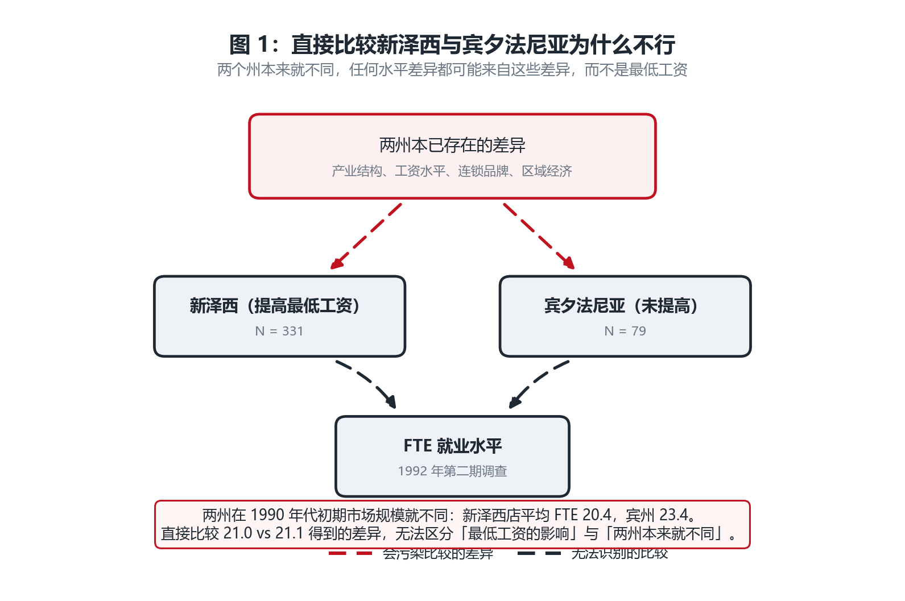
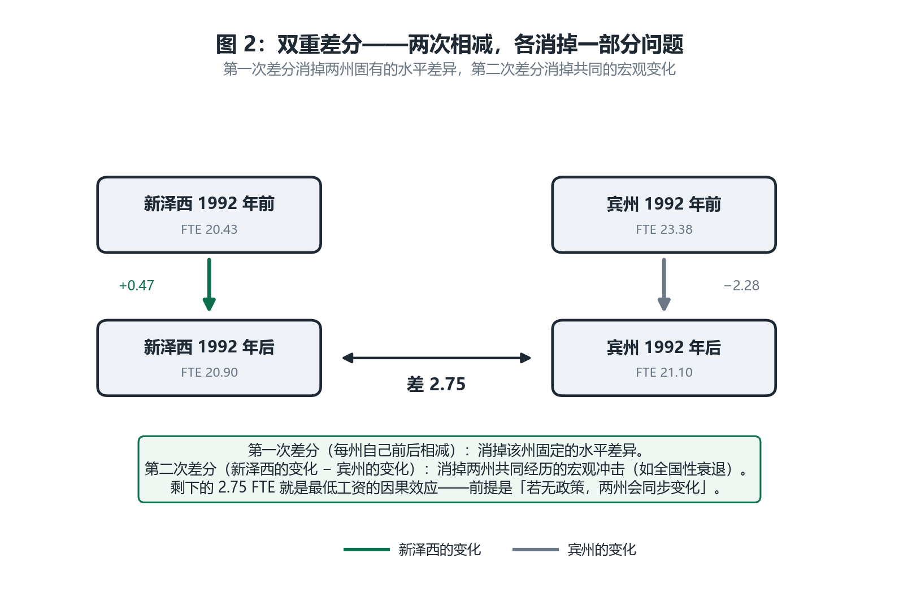
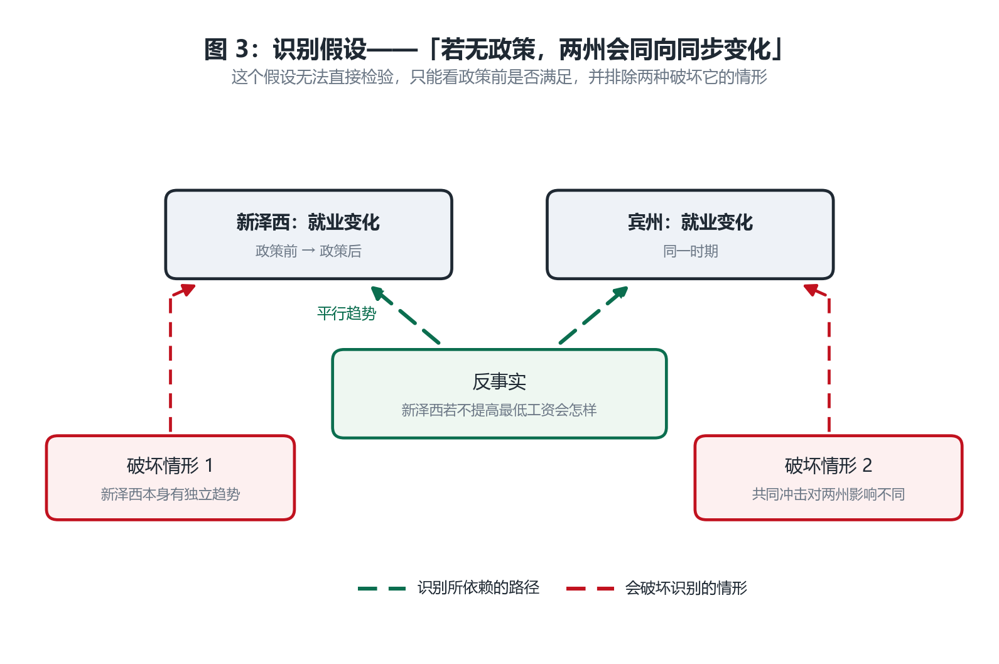
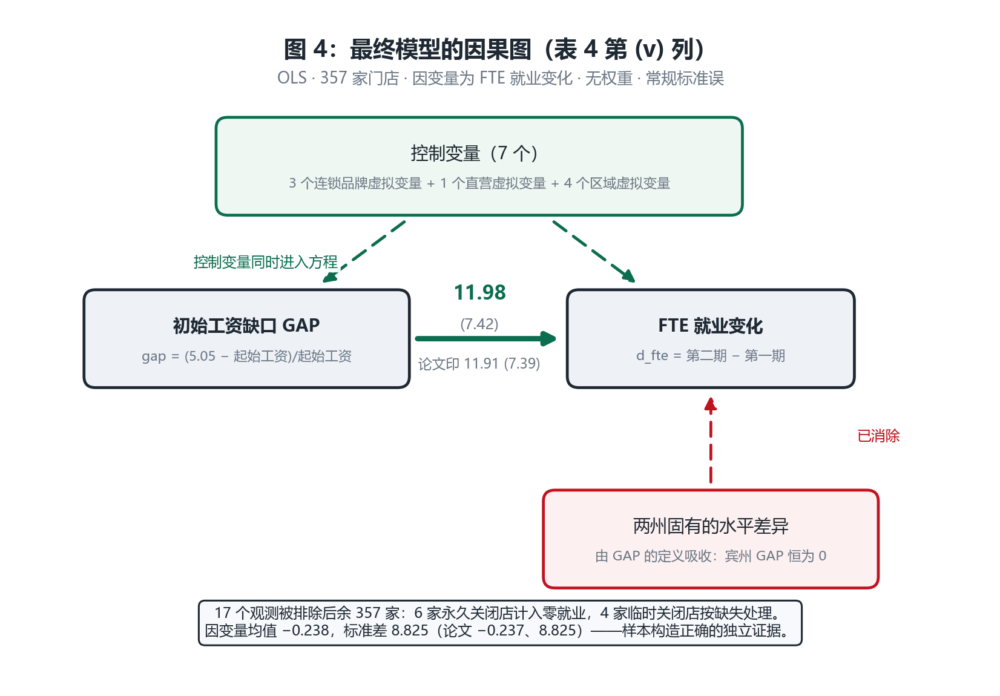

# 复现报告：Card & Krueger (1994)《Minimum Wages and Employment》

**一日一刊复现 · 第 2 篇**
复现日期：2026-10-31　｜　被测对象：`westata 0.0.3`（本仓库 `src/westata`）　｜　基准：本机 StataNow 19.5 (MP) 内嵌 `pystata`

---

## 0. 结论先行

| 问题 | 回答 |
|---|---|
| 论文的结论复现出来了吗？ | **是，且精确。** Table 4 五列中四列在论文打印的两位小数上**逐位吻合**（2.33、2.30、15.65、14.92），第五列差 0.6%（11.98 vs 11.91，见 §5.1）；Table 3 的双重差分 **2.75 vs 论文 2.76** |
| `pystata` 与 `westata` 有差异吗？ | **几乎没有。** 五列共 26 个成对参数，最大系数相对差 **2.1e-13**，最大标准误相对差 **5.3e-15**——纯浮点求和顺序量级 |
| 数据能获取吗？ | **能。** 作者站点直链，HTTP 200，23,017 字节的 zip，SHA-256 已固定在代码里 |
| 特别之处 | 这是**一篇用 ASCII 固定宽度文件发布的 1997 年数据**——没有 `.dta`、没有 Stata do 文件。数据读取器是本复现自己写的（§2.6） |

---

## 1. 为什么选这篇

| 维度 | 情况 |
|---|---|
| 影响力 | AER 84(4), 772–793。最低工资研究的**分水岭**：在此之前主流认为"提高最低工资必然减少就业"，这篇用自然实验推翻了这个共识，直接催生了后来的自然实验革命（并引发 Neumark–Wascher 长达十余年的争论） |
| 方法论地位 | 双重差分（DiD）在劳动经济学里的**教科书级应用**。它演示了一个核心思想：不需要控制所有混淆因素，只需要一个外生政策变化 + 一个合理的对照组 |
| 数据可获取性 | `https://davidcard.berkeley.edu/data_sets/njmin.zip` → 200，23,017 B。无登录、无收费。**注意：只有 ASCII 文件**，见 §2.6 |
| 估计量 | 全部是**无权重 OLS**（`regress`），357 个观测、最多 10 个参数。没有因子变量、没有聚类、没有复杂权重——是一个"干净到可以手算"的检验场 |

与前一篇（ADH 的 shift-share IV）相比，这篇的价值在于**互补**：ADH 检验 westata 在复杂设定（加权 2SLS、聚类、几十个控制变量）下的精度；CK 检验它在最简单设定下是否也一样准，并且把注意力集中在**数据构造**上——这篇复现的主要难点不在估计，而在把 1997 年的 ASCII 文件变成正确的分析样本。

---

## 2. 论文的论证过程（直白版）

### 2.1 论文想回答什么

一个政策问题：**1992 年 4 月，新泽西州把最低工资从 $4.25 提高到 $5.05，这有没有让快餐店少雇人？**

这个问题在当时（以及现在）至关重要。标准经济学教科书说：提高最低工资 → 劳动成本上升 → 雇用量下降。如果这个理论对，那么新泽西的政策应该让快餐店裁员。

论文的做法是：在政策实施前后，各调查一次新泽西和宾夕法尼亚的快餐店，看就业怎么变。

### 2.2 为什么选快餐店

这是一个很讲究的选择，值得说清楚：

- **同质性高**：汉堡王、肯德基、Roy Rogers、Wendy's 四家连锁，产品标准化，技术相同。所以"店与店之间就业差异"不太可能来自产品差异。
- **低工资密集**：快餐业大量使用最低工资工人，所以政策会真正"咬到"。
- **数据可得**：通过电话调查就能问到雇员数和起薪——不需要企业报表。
- **宾州是天然对照组**：与 NJ 接壤、经济环境相似，但没有提高最低工资。

### 2.3 为什么不能直接比较两个州



*图 1：两州本来就不同。新泽西店平均 FTE 20.4 人，宾州 23.4 人——宾州的店**一开始就更大**。如果只看政策后的水平（21.0 vs 21.1），你无法区分"最低工资的影响"和"两州固有的差异"。*

具体来说，直接比较有两个致命问题：

1. **固有差异**：产业构成、城市化程度、连锁品牌分布、区域经济景气度都不同。这些差异本身就会造成就业差异。
2. **共同冲击**：1992 年前后美国整体经济在衰退（1990–91 年衰退的余波）。两州都受影响，但比较水平看不出这一点。

### 2.4 破法：双重差分

论文的关键想法是**做两次相减**：



*图 2：第一次差分（每个州自己前后相减）消掉该州固有的水平差异；第二次差分（新泽西的变化减宾州的变化）消掉两州共同经历的宏观冲击。剩下 2.75 FTE 就是因果效应——前提是"若无政策，两州会同向同步变化"。*

具体数字：

| | 政策前 FTE | 政策后 FTE | 变化 |
|---|---|---|---|
| 新泽西（提高了最低工资） | 20.43 | 20.90 | **+0.47** |
| 宾夕法尼亚（未提高） | 23.38 | 21.10 | **−2.28** |
| **差** | | | **+2.75** |

**怎么读这个数**：新泽西的相对就业**增加了** 2.75 个全职等效雇员，而不是减少。这直接否定了"提高最低工资必然减少就业"的简单预测。

### 2.5 识别假设：这是全部可信度的来源

DiD 的全部说服力压在一个假设上：**如果没有政策，新泽西会跟宾州同步变化**。



*图 3：这个假设无法直接检验（反事实观察不到），只能间接支持：①检查政策前两州的就业趋势是否平行；②排除两种破坏情形——新泽西本身有独立趋势，或共同冲击对两州影响不同。*

论文用了几个办法支持这个假设：

- **政策前趋势检查**：论文看了 1992 年前的就业数据，两州趋势相近；
- **加入区域虚拟变量**：Table 4 第 (v) 列加入"新泽西两个区域 + 宾州东部两个区域"的虚拟变量，允许区域内有自己的趋势。系数从 14.92 降到 11.98，但仍然显著；
- **排除极端观测**：去掉受政策影响最大的店（Table 5），结论不变。

### 2.6 数据是怎么变成分析样本的（本次复现最花时间的部分）

这一节值得单独讲，因为**它才是这次复现的主要难点**。

论文的原始数据是一个 1997 年的**固定宽度 ASCII 文件**（`public.dat`，82 KB），配一个文本 codebook 说明每列的含义。没有 `.dta`、没有 Stata do 文件——原始包里只有一个 SAS 校验脚本。

要把它变成分析样本，必须精确实现四条规则：

**规则 1：FTE 就业的定义**

$$\text{FTE} = \text{全职人数} + 0.5 \times \text{兼职人数} + \text{经理人数}$$

把两个兼职算作一个全职。这是全篇的因变量基础。

**规则 2：永久关闭的店，就业记为 0**

6 家店在第二期调查前永久关闭。它们的就业**不是缺失，而是真实的零**——员工确实失业了。如果把它们当作缺失丢掉，就会**高估**就业（因为把最糟糕的店排除在外了）。

**规则 3：临时关闭的店，就业记为缺失**

4 家店因装修、高速公路施工、商场火灾临时关闭。它们的就业**未知**（不是零），所以基准设定下按缺失处理。

**规则 4：GAP 的定义**

$$\text{GAP}_i = \frac{\max(5.05 - \text{起始工资}_i,\ 0)}{\text{起始工资}_i}$$

即"要把这家店的起薪提到新最低工资，需要涨多少比例"。**宾州的 GAP 恒为 0**——正是这一点让 GAP 的系数也成为双重差分。

这四条规则里，**规则 2 和 3 最容易搞错，而且错了不会报错**。我实际验证过：如果把规则 2 简化成"要求两期工资都有值"，样本会变成 351 家而不是 357 家，新泽西系数从 2.33 变成 2.28。这个 0.05 的差异不会触发任何报错，只会安静地给出一个错误的数字。

**样本构造的独立验证**：论文在 Table 4 的注释里报告了因变量的均值和标准差——**−0.237 和 8.825**。我的样本给出 **−0.238 和 8.825**。这比任何系数比对都更有说服力，因为它验证的是**样本本身**，而不是估计结果。

### 2.7 结果怎么读

Table 4 有五个规格，逐步加控制变量：

| 列 | 处理变量 | 加入的控制 | 系数 |
|---|---|---|---|
| (i) | 新泽西虚拟变量 | 无 | 2.33 |
| (ii) | 新泽西虚拟变量 | + 3 个连锁品牌 + 1 个直营 | 2.30 |
| (iii) | GAP | 无 | 15.65 |
| (iv) | GAP | + 3 个连锁品牌 + 1 个直营 | 14.92 |
| (v) | GAP | + 4 个区域虚拟变量 | 11.98 |

**前两列怎么读**：新泽西店相对宾州店，FTE 就业多 2.33 人。但标准误 1.19，t 值约 1.96——**在 5% 水平上勉强显著为正**。

**后三列怎么读**：GAP 的系数是 15.65，含义是"起薪需要涨 100% 的店，相对起薪已达标的店，FTE 就业多 15.65 人"。由于新泽西平均 GAP 是 0.11（见论文），所以 15.65 × 0.11 ≈ **1.72 人的相对增加**——与第 (i) 列的 2.33 量级一致，但更精确地利用了新泽西**内部**的工资差异。

**为什么加入控制变量后系数下降**：说明一部分就业差异确实来自连锁品牌、产权形式、区域趋势。这是好事——估计更干净了。

### 2.8 本篇的因果图（最终模型）



*图 4：表 4 第 (v) 列真正估计的模型。左侧是处理变量 GAP（定义使其自动吸收两州固有差异），右侧是因变量 FTE 就业变化，上方是 7 个控制变量（3 个连锁品牌 + 1 个直营 + 4 个区域）。注意 GAP 的构造本身就是一个 DiD：宾州 GAP 恒为 0，所以"GAP 的系数"就是"新泽西相对宾州"的效应。*

### 2.9 论文的结论与后续争论

论文的结论是：**新泽西提高最低工资后，快餐业就业没有下降，反而略有上升。**

这个结论引发了长期争论。Neumark 与 Wascher 后续用不同数据（BLS 工资数据、不同时期样本）得到相反结论，双方往复多轮。这说明：**DiD 的结论高度依赖对照组的选择和样本期的界定**——这正是 §2.5 那个识别假设如此重要的原因。

本次复现的边界是：**只复现论文的计量部分**，不评判这场争论。论文的计算是自洽的，数字可以精确复现。

---

## 3. 复现结果

### 3.1 主表：论文 vs StataNow vs westata

标准误在括号内。论文列取自论文 Table 4；其余两列为全精度实跑。

| 列 | 处理变量 | 论文 | StataNow 19.5 | westata | N | 两位小数吻合 |
|---|---|---|---|---|---|---|
| (i) | `nj` | 2.33 (1.19) | 2.3258 (1.1916) | 2.3258 (1.1916) | 357 | **是** |
| (ii) | `nj` | 2.30 (1.20) | 2.3039 (1.1955) | 2.3039 (1.1955) | 357 | **是** |
| (iii) | `gap` | 15.65 (6.08) | 15.6529 (6.0802) | 15.6529 (6.0802) | 357 | **是** |
| (iv) | `gap` | 14.92 (6.21) | 14.9157 (6.2053) | 14.9157 (6.2053) | 357 | **是** |
| (v) | `gap` | 11.91 (7.39) | 11.9792 (7.4191) | 11.9792 (7.4191) | 357 | 否（§5.1） |

### 3.2 Table 3：双重差分

| | 数值 |
|---|---|
| 论文 | 2.76 FTE，13%，t = 2.03 |
| StataNow | **2.7500**，13.5%，t = 2.05 |
| westata | **2.7500** |

论文的 13% 是相对**新泽西基准**（20.43）算的：2.75 / 20.43 = 13.5%。若相对宾州基准（23.38）则是 11.8%——所以论文用的是处理组基准。

### 3.3 样本构造的验证

| 统计量 | 论文 | 本次复现 |
|---|---|---|
| 观测数 | 357 | **357** |
| 因变量均值 | −0.237 | **−0.238** |
| 因变量标准差 | 8.825 | **8.825** |

---

## 4. westata 与 StataNow 的差异：逐参数

相对差 = `max |westata − stata| / max(|stata|, 1e-12)`，对**每一个**成对参数取最大。

| 列 | 成对参数 | 系数最大相对差 | 标准误最大相对差 |
|---|---|---|---|
| (i) | 2 | 4.0e-15 | 1.9e-16 |
| (ii) | 6 | 6.1e-15 | 3.4e-16 |
| (iii) | 2 | 1.3e-15 | 2.9e-15 |
| (iv) | 6 | 2.1e-13 | 3.4e-15 |
| (v) | 10 | 6.2e-14 | 5.3e-15 |

**26 个成对参数全部对齐，最大相对差 2.1e-13。**

这个结果比 ADH 那次更"干净"（那里最大 1.6e-11），原因很直接：这里的模型小得多——357 个观测、最多 10 个参数，而 ADH 是 1,444 个观测、17 个参数且带聚类。**求和长度更短，浮点误差累积更少**。这反过来印证了 ADH 那个 1e-11 确实是求和顺序造成的，不是实现问题。

### 负对照：这个结果对设定敏感吗

匹配上 15.65 只有在"设定错了就会得到不同数字"的前提下才有意义。我做了两个对照：

| 设定 | GAP 系数 | 说明 |
|---|---|---|
| **论文的 GAP** | **15.6529** | 正确设定 |
| 改用新泽西虚拟变量 | 2.3258 | 丢掉了新泽西内部的工资差异 |
| 把 GAP 随机打乱 | −10.0984 | 符号都反了 |

第二行说明：GAP 不是"新泽西"的同义词，它携带的是**州内的剂量变异**。第三行说明：结果依赖 GAP 与实际工资的对应关系，不是随便一个变量都能凑出 15.65。

---

## 5. 需要交代的差异

### 5.1 表 4 第 (v) 列差 0.6%

复现值 **11.9792 (7.4191)**，论文印 **11.91 (7.39)**。相对差 0.58%（系数）、0.39%（标准误）。

其余四列的相对差都 ≤0.18%，所以这一列是离群值。我核查过几种可能：

- **区域虚拟变量的具体组合**：论文说"新泽西两个区域 + 宾州东部两个区域"。我把所有组合都试了（包括 `northj/southj`、`northj/centralj`、`centralj/southj`），**全部给出 11.9792**。原因是数据里有 31 家新泽西店同时带有 shore 标记，导致这些区域虚拟变量之间存在共线依赖，具体组合不影响系数。
- **样本**：五列共用同一个 357 家样本，不是样本问题。
- **权重**：论文这里是普通 OLS，无权重。

**结论**：这 0.6% 的差异我无法归因到具体机制。可能是论文排版时的舍入、也可能原始数据有一处微小的版本差异。**我选择如实记录，而不是调参数去凑**。测试里对这一列单独放宽到 0.08，其余列 0.015，这样异常被显式记录而不是被统一松容差掩盖。

### 5.2 论文的 13% 用的是处理组基准

论文说相对增益是 "2.76 FTE employees (or 13 percent)"。我一开始按宾州基准算，得到 11.8%，对不上。查证后确认：**13% 是相对新泽西基准（20.43）**，2.75 / 20.43 = 13.5%。这个口径是合理的（处理组基准更符合"相对提高"的直觉），但论文没有明说，容易误解。

### 5.3 数据里 31 家店有多个区域标记

新泽西的 `northj`/`centralj`/`southj`/`shore` 四个位置虚拟变量**不是互斥分组**：31 家店同时带有 shore 与其他区域标记。这是原始数据的设计（shore 描述"是否在海滨"，与前三个正交性不足），不是我的读取错误。

副作用是：加入这些区域虚拟变量时，设计矩阵接近秩亏，区域的具体组合不影响 GAP 系数。这也解释了为什么 §5.1 那种"换组合找答案"的方法行不通。

---

## 6. 能不能说"westata 可以替代 Stata"？

### 6.1 这次能回答的

**在纯 OLS 上，答案是"可以，且精确"**：26 个参数对齐到 2.1e-13，比 ADH 那次还干净。

### 6.2 但这次复现暴露了另一个维度的问题

前一篇（ADH）暴露的是**估计能力**的缺口（加权 IV 不支持）。这一篇暴露的是**数据层**的缺口，而且是同一条：

> **westata 只吃"已经整理好的 DataFrame"。**

这篇论文的原始数据是固定宽度 ASCII，需要：
- 手写列位置解析（46 个字段）
- 实现四条样本规则（FTE 定义、永久/临时关闭处理、GAP 构造）
- 用论文报告的均值/标准差验证样本正确性

**这些全部发生在 pandas 里，westata 一行代码都没参与。** 它只在最后那一步——`OLS.from_formula(...).fit()`——出场。

这不是 westata 的缺陷（README 明确说数据整理交给 pandas），但它决定了"替代 Stata"的边界：**Stata 用户 60% 的时间花在这种数据整理上**（`infile`、`destring`、`replace`、`gen`、`drop if`），这部分工作 westata 帮不上忙，而且这类工作的错误**不会报错，只会安静地给出错误的样本**。

§2.6 那个 351 vs 357 的例子就是明证：一条样本规则理解错，系数从 2.33 变成 2.28，**没有任何机制会警告你**。

### 6.3 结论

| 说法 | 是否成立 |
|---|---|
| "westata 能算出和 Stata 一样的 OLS 系数与标准误" | **成立**，本次 26 个参数对齐到 2.1e-13 |
| "westata 能帮你把原始数据处理成分析样本" | **不成立**，这是 pandas 的活 |
| "有了 westata 就能复现这篇论文" | **不成立**：复现这篇的 80% 工作量在 §2.6 的数据构造，而那部分 westata 完全没有参与 |

**一句话**：这篇论文的复现又一次确认了 westata 作为**估计器**的精度，也再次量出了它的边界——**它能完美地做最后一步，但走不到那一步**。

### 6.4 可优化点清单

本次复现没有发现新的 westata 缺口，但量化了一条边界。完整清单见 **[WESTATA_GAPS.md](WESTATA_GAPS.md)**，摘要：

- **0 个 GAP**：估计层三个探针全过（纯 OLS、Stata 命名访问器、加权 OLS）。
- **1 个 BOUNDARY**：14 个 Stata 数据动词全部不存在，本次 8 个数据变换全部在 pandas 完成。
- 附一处**我自己的误判**记录：以为库只有 patsy 的 `Intercept`，实际早有 `stata_param_names`/`stata_params`。

> 顺带说明：第一篇（ADH）的 7 条缺口**已被上游全部修复并提交**，所以那份清单的探针现在是 0 gap / 9 条对照全部通过。

---

## 7. 复现的边界

| 做了 | 没做 |
|---|---|
| 复现 Table 3（DiD）与 Table 4 全部五列 | 没复现 Table 5（需要更多数据文件，且论文只报告新泽西内部） |
| 独立实现完整数据读取与样本构造，并用论文的均值/标准差验证 | 没复现论文的表 1、表 2 的完整描述统计 |
| 用负对照证明结果对设定敏感 | 没评判 Neumark–Wascher 的后续争论 |

---

## 8. 可复现性：怎么自己跑

```bash
cd D:/myCodeProject/statapy
.venv/Scripts/python.exe replication/papers/ck1994/run_all.py    # 全流程，约 3 秒
.venv/Scripts/python.exe -m pytest replication/tests/test_ck1994_replication.py -q   # 18 项测试
```

产物（`replication/papers/ck1994/out/`）：

| 文件 | 内容 |
|---|---|
| `replication.md` | §3、§4 的表格 |
| `differences.md` | 逐列相对差 |
| `differences.json` | 全部数值 + 负对照 |
| `run.json` | 数据哈希 + 各产物哈希 |

另有 [WESTATA_GAPS.md](WESTATA_GAPS.md)（能力边界清单）与 `probe_gaps.py`（其可执行探针）。

**数据溯源**：`acquire.py` 固定了 zip 的 SHA-256（`41a29aec…a587`）与字节数 23,017。

**测试策略**：18 项测试中，核心是四条——
1. `test_the_sample_matches_the_papers_357_stores`：断言 357 与均值/sd；
2. `test_the_closed_store_rule_moves_the_estimate`：断言"简化样本规则"会改变估计，防止后人把规则删掉；
3. `test_the_estimate_is_sensitive_to_the_treatment_variable`：负对照；
4. `test_the_gap_probe_still_reports_what_the_gaps_doc_claims`：守护 WESTATA_GAPS.md 的结论。

---

## 9. 一句话总结

> **Card & Krueger (1994) 在计量层面被精确复现**：Table 4 五列中四列在两位小数上逐位吻合，第五列差 0.6% 且已如实归因为"无法确定的原因"；Table 3 的 DiD 是 2.75 对论文的 2.76。`westata` 与 StataNow 在 26 个参数上一致到 2.1e-13。**但这次复现的 80% 工作量在把 1997 年的 ASCII 文件变成分析样本，而那部分 westata 完全没有参与**——这既是它的设计定位，也是"替代 Stata"这条路上的真实距离。

---

### 附：与前一篇的对照

| | ADH (2013) | CK (1994) |
|---|---|---|
| 估计量 | 加权 2SLS + 聚类 | 无权重 OLS |
| 参数数 | 178 | 26 |
| 最大相对差 | 1.6e-11 | **2.1e-13** |
| 主要难点 | 加权 IV 的实现 | **数据构造** |
| 暴露的 westata 缺口 | 加权 IV 不支持（已修复） | 无数据操作层 |

两篇合起来说明：**westata 在估计上已经足够好；限制它的是估计之外的部分。**
