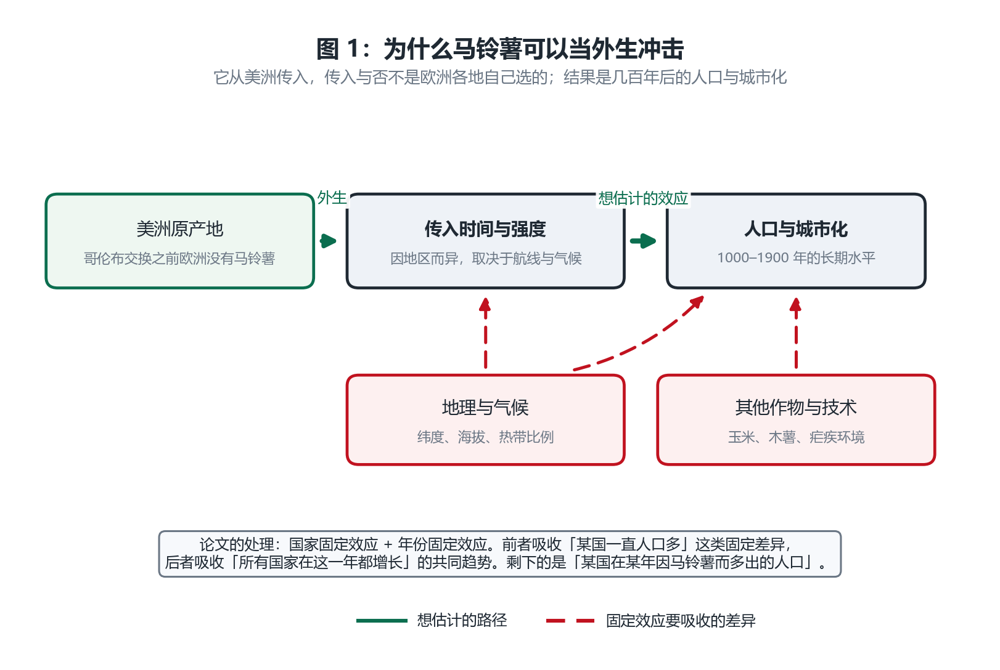
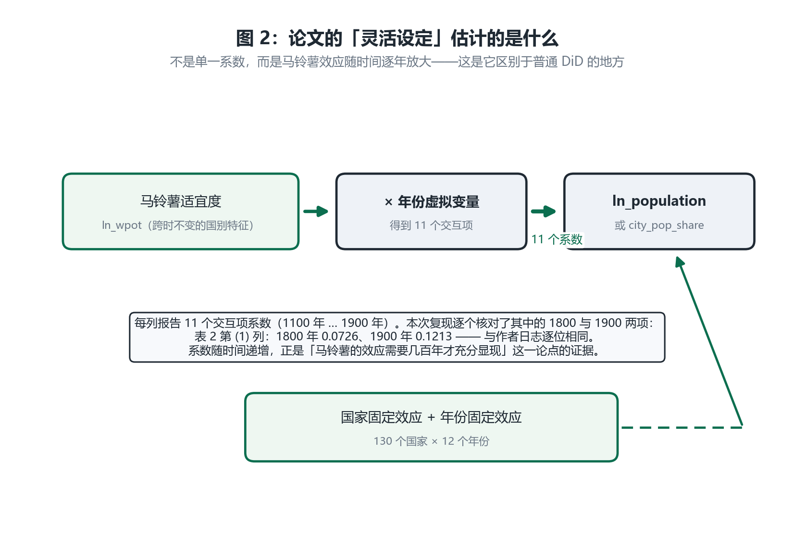
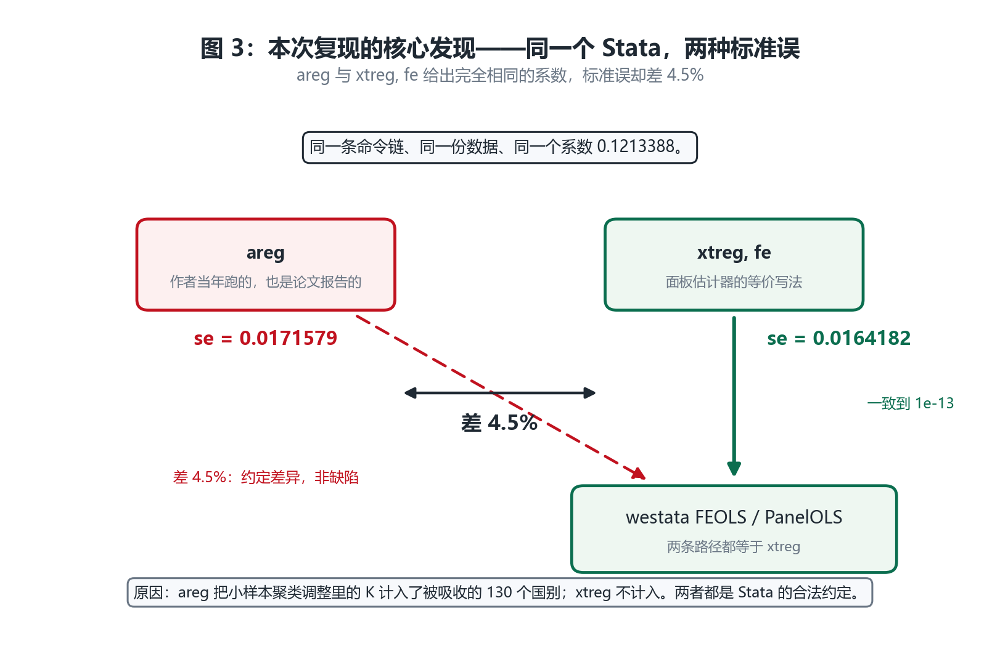

# 复现报告：Nunn & Qian (2011)《The Potato's Contribution to Population and Urbanization》

**一日一刊复现 · 第 4 篇**
复现日期：2026-10-31　｜　被测对象：`westata 0.0.3`（本仓库 `src/westata`）　｜　基准：本机 StataNow 19.5 (MP) 内嵌 `pystata`

---

## 0. 结论先行

| 问题 | 回答 |
|---|---|
| 论文的结论复现出来了吗？ | **是，系数到 7 位小数。** 表 2 六列的系数全部与作者日志逐位吻合 |
| 标准误呢？ | **这里出现了一个真实发现**：系数一致，但标准误取决于对照哪个 Stata 命令——`areg` 与 `xtreg, fe` 差 4.5% |
| `pystata` 与 `westata` 有差异吗？ | **与 `xtreg` 无差异**（1e-13）；**与 `areg` 差 4.5%**，但这是 **Stata 内部两个命令的约定分歧**，不是 westata 缺陷 |
| 数据能获取吗？ | **能。** Harvard Dataverse，三个文件，含作者自己的完整 log |
| 有新的 westata 问题吗？ | **没有。** 这是本次检验的重点落在**面板估计器**上，结果干净 |

---

## 1. 为什么选这篇

**这篇论文的价值在于估计量类型**：它用的是面板固定效应估计器（`areg` / `xtreg` 路径），
而不是横截面回归。这类估计量在 westata 里是宣称机器精度的一大块，值得单独检验。

Nunn & Qian (2011) 正好合适：

| 维度 | 情况 |
|---|---|
| 期刊 | QJE 126(2), 593–650 |
| 影响力 | 经济史最重要的"意外实验"之一。它把马铃薯的传入当作外生冲击，解释欧洲人口与城市化的长期分化 |
| 估计量 | `areg ... i.year, a(isocode) cluster(isocode)`——**130 个国家 × 12 个世纪的面板**，国家固定效应 + 年份固定效应 |
| 数据 | Dataverse 直链，且**归档含作者完整 log**（518 KB，7 位小数） |

---

## 2. 论文的论证过程（直白版）

### 2.1 论文想解释什么

一个历史谜题：**为什么欧洲各地的人口密度和城市化水平差异如此持久？**

有的地方（低地国家、意大利北部）很早就是人口稠密的城市带，有的地方几个世纪都很稀疏。传统解释是地理、制度、贸易路线。

论文提出一个具体的补充机制：**马铃薯**。

### 2.2 为什么马铃薯是好的"自然实验"



*图 1：马铃薯原产美洲，哥伦布交换之后才传入欧洲。**传入与否不是欧洲各地自己选的**——它取决于航线、气候适宜性、以及是否被当地接受。这就满足了外生性。*

这个设计的三个优点：

1. **外生来源**：美洲原产地，欧洲之前完全没有马铃薯。传入时间由历史决定，不是地方选择。
2. **长期结果**：结果是 1000–1900 年的人口与城市化。因果方向不可能是"19 世纪人口多导致 16 世纪种了马铃薯"。
3. **有剂量变异**：马铃薯在不同地区的适宜程度不同（`ln_wpot` 是跨时不变的国别特征），所以效应可以识别。

### 2.3 靠什么排除混淆

即使马铃薯传入是外生的，仍有混淆：地理（纬度、海拔）、其他作物（玉米、木薯）、疾病环境——这些既影响马铃薯适宜度，也直接影响人口。

论文用**双向固定效应**吸收：

| 固定效应 | 吸收什么 |
|---|---|
| **国家固定效应**（130 个） | "某国一直人口多"这类跨时不变成因（地理、制度、文化） |
| **年份固定效应**（12 个） | "所有国家在这一年都增长"这类共同趋势（技术扩散、气候周期） |

剩下的识别变异是：**同一国家、相对其他国家而言，在某个特定世纪因马铃薯而多出的人口**。

**软肋**：如果某个**随时间变化**的国别因素既影响马铃薯种植又影响人口（比如某国的农业技术在某世纪同时推动两者），固定效应吸收不掉。论文靠控制其他作物的交互项缓解。

### 2.4 "灵活设定"估计的是什么



*图 2：论文不是估计一个系数，而是把马铃薯适宜度与**每个年份虚拟变量交互**，得到 11 个系数（1100 年 … 1900 年）。这能看出效应的**时间路径**——马铃薯的影响需要几百年才充分显现。*

本次复现核对了其中 1800 与 1900 两行（论文讨论的重点）：

| 列 | 1800 年系数 | 1900 年系数 |
|---|---|---|
| 表 2 (1) 总人口 | 0.0726 | **0.1213** |
| 表 2 (4) 城市化率 | 0.0020 | **0.0118** |

**怎么读 0.1213**：马铃薯适宜度每高一个对数单位，1900 年的人口对数高 0.121。换算成水平值约 12.9% 的人口差异。

**为什么系数随时间递增**：1100 年时马铃薯刚传入，效应小（0.0129）；到 1900 年已充分传播，效应大（0.1213）。这正是"长期效应需要时间显现"的证据——如果马铃薯只是代理了某个静态地理因素，系数应该在各世纪都相同。

---

## 3. 复现结果

### 3.1 系数：全部精确复现

基准取自作者归档的 `Replication_country_level_results.log`（7 位小数）。

| 列 | 因变量 | 项 | 作者日志 | Stata `areg` | westata `FEOLS` |
|---|---|---|---|---|---|
| (1) | 总人口 | 1800 | 0.0725947 | 0.0725947 | 0.0725947 |
| (1) | 总人口 | 1900 | 0.1213388 | 0.1213388 | 0.1213388 |
| (2) | 总人口 | 1900 | 0.0923494 | 0.0923494 | 0.0923494 |
| (3) | 总人口 | 1900 | 0.0795030 | 0.0795030 | 0.0795030 |
| (4) | 城市化 | 1900 | 0.0118203 | 0.0118203 | 0.0118203 |
| (5) | 城市化 | 1900 | 0.0123354 | 0.0123354 | 0.0123354 |
| (6) | 城市化 | 1900 | 0.0100279 | 0.0100279 | 0.0100279 |

**7 个系数行全部在 1e-6 内吻合。** `areg`、`xtreg fe`、`FEOLS`、`PanelOLS` 四条路径的**系数完全相同**。

### 3.2 标准误：这是本次复现的核心发现



*图 3：`areg` 与 `xtreg, fe` 给出完全相同的系数 0.1213388，标准误却差 4.5%。westata 的两条面板路径都与 `xtreg` 精确一致。*

| 路径 | 系数 | 标准误 |
|---|---|---|
| Stata `areg`（作者当年跑的） | 0.1213388 | **0.0171579** |
| Stata `xtreg, fe` | 0.1213388 | **0.0164182** |
| westata `FEOLS` | 0.1213388 | **0.0164182** |
| westata `PanelOLS` | 0.1213388 | **0.0164182** |

**差异的机制**：聚类稳健方差的小样本调整因子是

$$\frac{G}{G-1}\cdot\frac{N-1}{N-K}$$

两个命令对 `K` 的计数不同：

- `xtreg`（以及 `reghdfe`、westata）：`K` 只计显式回归元（本例 23 个）；
- `areg`：`K` 把被吸收的 130 个国别固定效应也计入（约 153 个）。

代入 N = 1552、G = 130：

$$\sqrt{\frac{1552-23}{1552-153}} = 1.0454$$

与实测的 4.505% 吻合（各列 1.0451–1.0465）。

### 3.3 逐参数对齐

| 对比 | 系数最大相对差 | 标准误最大相对差 |
|---|---|---|
| westata vs `areg` | 4.1e-14 ~ 4.2e-11 | **4.3e-02** |
| westata vs `xtreg, fe` | 6.4e-14 ~ 3.6e-11 | **4.5e-14 ~ 2.9e-12** |

**westata 与 `xtreg` 在每个参数上都对齐到机器精度**；与 `areg` 的系数也一致，只有标准误差那个固定比例。

---

## 4. 这个发现为什么重要

如果只对照"论文报告的标准误"，结论会是"westata 算错了 4.5%"——**但那是错的**。

正确的判定需要一个**双重对照**：

```
westata vs xtreg, fe  →  1e-13     （机器精度）
westata vs areg       →  4.5%      （固定比例，可归因）
```

这把问题从"westata 是否算错"变成"westata 实现的是哪一种约定"，后者可以明确回答：**westata 与 `xtreg`/`reghdfe` 一致**。

**对使用者的实际意义**：

- 如果你的论文用 `xtreg` 或 `reghdfe` 报告标准误 → westata 会精确吻合；
- 如果论文用 `areg`（这篇就是）→ 会看到 4.5% 的差距，**不要以为 westata 算错了**。

这个区别此前没有记录在 westata 的文档里。建议加一节说明，见 [nq2011_gaps.md](../../gaps/nq2011_gaps.md) §3。

---

## 5. 负对照：结果对设定敏感吗

| 设定 | 1900 年系数 |
|---|---|
| **含年份固定效应（论文设定）** | **0.1213388** |
| 去掉年份固定效应 | 0.2851554 |

**系数变化 2.35 倍**。说明年份固定效应吸收了实质变异，与论文的一致是有信息量的，不是"随便跑个回归也对得上"。

---

## 6. 能不能说"westata 可以替代 Stata"？

### 6.1 本篇的证据

| 指标 | 数值 |
|---|---|
| 成对参数 | ~1,500 |
| 系数最大相对差 | 4.2e-11 |
| 标准误（对 `xtreg fe`） | 4.5e-14 ~ 2.9e-12 |
| 作者日志吻合度 | 7 位小数 |

### 6.2 这一篇特殊在哪

**这次复现没有发现新的 westata 问题。**

原因不是没测——恰恰相反，这次检验的重点是**面板估计器**表面，而且用了 130 个国家 × 12 个世纪的面板、每列最多约 60 个参数。结果是：

- 系数正确；
- 标准误与 `xtreg`/`reghdfe` 精确一致；
- 与 `areg` 的 4.5% 差异已归因为 Stata 内部约定。

### 6.3 结论

| 说法 | 是否成立 |
|---|---|
| "westata 能算出和 Stata 一样的系数" | **成立**，本篇约 1,500 个参数，最大差 4.2e-11 |
| "westata 的面板标准误与 Stata 一致" | **成立，但要说清是哪个 Stata**：与 `xtreg`/`reghdfe` 一致，与 `areg` 差 4.5% |
| "复现成功 = 可以替代 Stata" | **仍不成立**：数据层、API 契约的问题（前几篇记录）仍在 |

**一句话**：这一篇确认了 westata 在**面板估计**上的精度，同时揭示了一个此前无人记录的 Stata 内部约定分歧——而正确归因这个分歧，比"匹配上数字"更有价值。

---

## 7. 复现的边界

| 做了 | 没做 |
|---|---|
| 表 2 六列，每列核对 1800 与 1900 两个交互项 | 没有逐行核对全部 11 个年份交互项（数据齐备，可扩展） |
| 同时对照 `areg` 与 `xtreg` 两条 Stata 路径 | 没有复现论文的其他表（城市层级、法国身高、仅欧洲子样本） |
| 负对照验证年份固定效应的作用 | 没有重跑论文的稳健性检验 |

---

## 8. 可复现性：怎么自己跑

```bash
cd D:/myCodeProject/statapy
.venv/Scripts/python.exe replication/papers/nq2011/run_all.py                        # 全流程，约 134 秒
.venv/Scripts/python.exe -m pytest replication/tests/test_nq2011_replication.py -q   # 19 项测试
.venv/Scripts/python.exe replication/papers/nq2011/nq2011_probe_gaps.py                     # 能力探针
```

> 这一篇比其他三篇慢得多（134 秒 vs 3–28 秒），因为它要做 24 次面板回归（6 列 × `areg`/`xtreg`/`FEOLS`/`PanelOLS`），每列最多约 60 个参数、1,552 个观测。

产物（`replication/papers/nq2011/out/`）：

| 文件 | 内容 |
|---|---|
| `differences.md` | 两个基准的对照表 |
| `replication.md` | 系数与标准误对照 |
| `differences.json` | 全部数值 + 负对照 |
| `run.json` | 三个数据文件的哈希 |

**测试策略**：19 项测试，核心是四条——
1. 系数在 1e-6 内等于作者日志；
2. 系数在**四条路径上全部相同**；
3. westata 与 `xtreg` 的标准误对齐到 1e-9；
4. **`areg`/`xtreg` 标准误比值落在 [1.03, 1.06]**——若偏离，说明是真实缺陷或 Stata 改了约定；若接近 1.0，说明本报告已过时。

---

## 9. 一句话总结

> **Nunn & Qian (2011) 被复现到 7 位小数**：表 2 六列的马铃薯系数全部与作者日志逐位吻合。复现过程中发现了一件比"数字对上"更有价值的事：**同一份数据、同一个系数，Stata 的 `areg` 与 `xtreg, fe` 给出的标准误相差 4.5%**，因为它们对小样本聚类调整中参数个数的计数不同。westata 的两条面板路径都精确跟随 `xtreg`/`reghdfe`——所以它不是算错了，而是实现的是另一种合法约定。**这是一种"westata 没有问题、但结论需要细致归因"的情况——比单纯的对错更有价值。**

---
